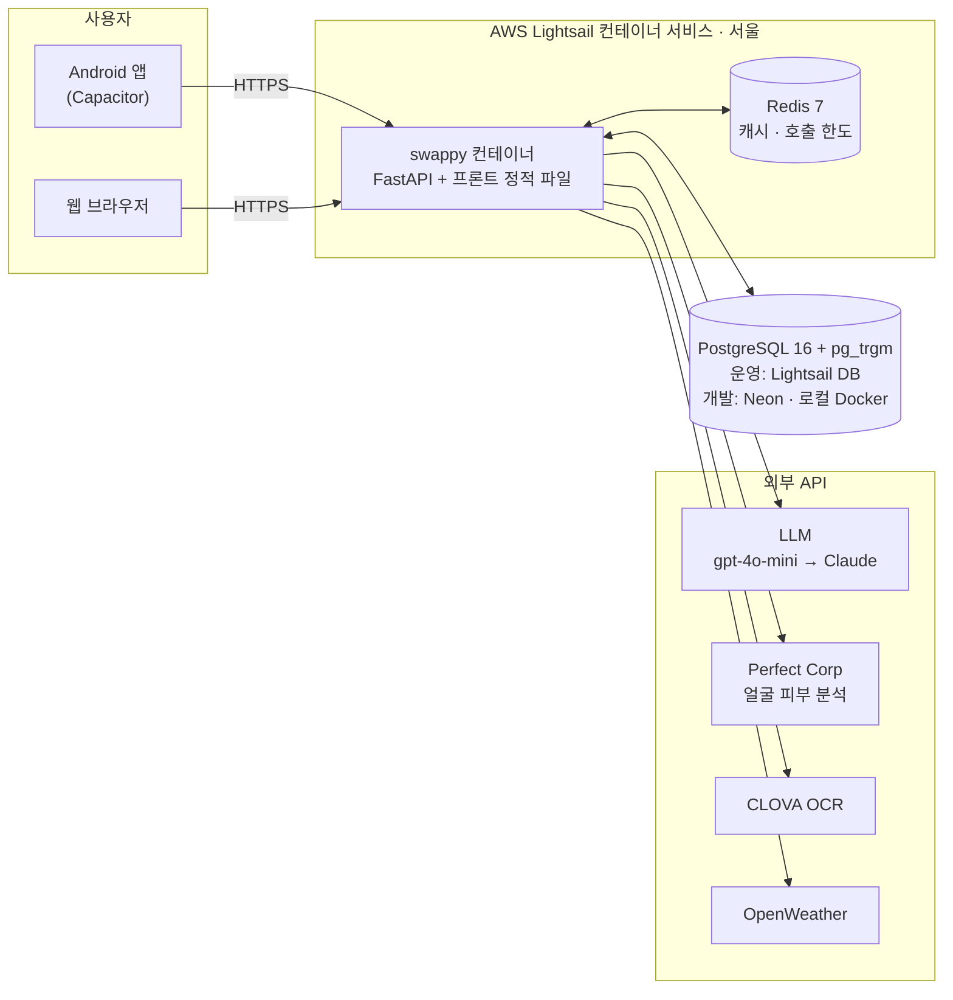
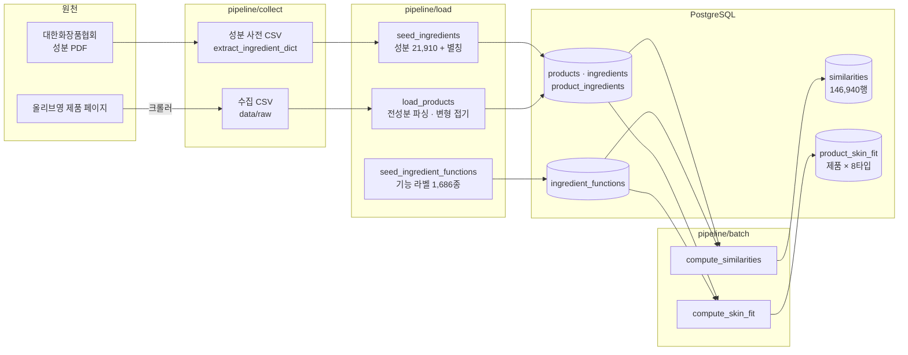
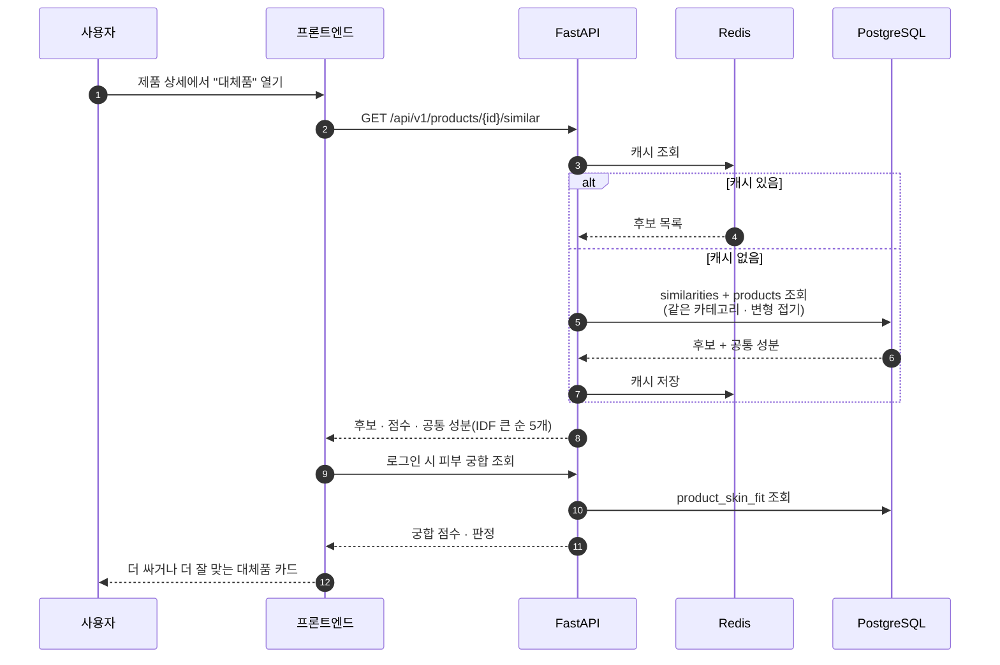
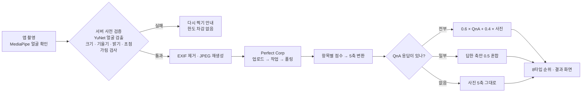
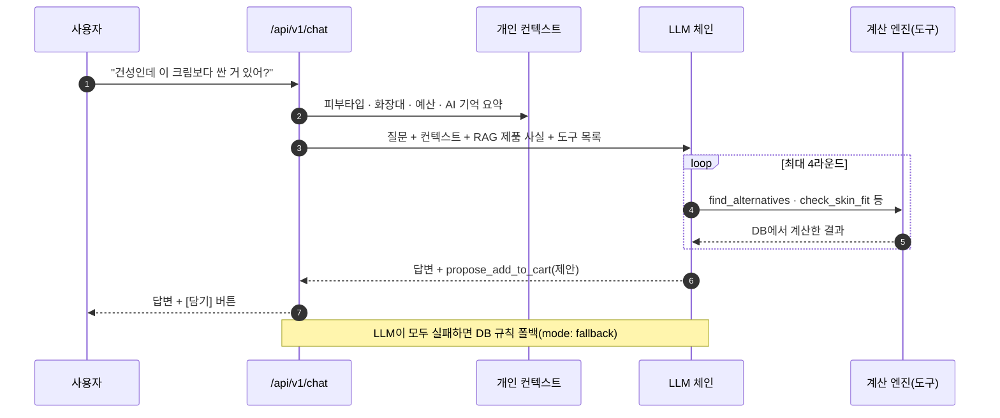
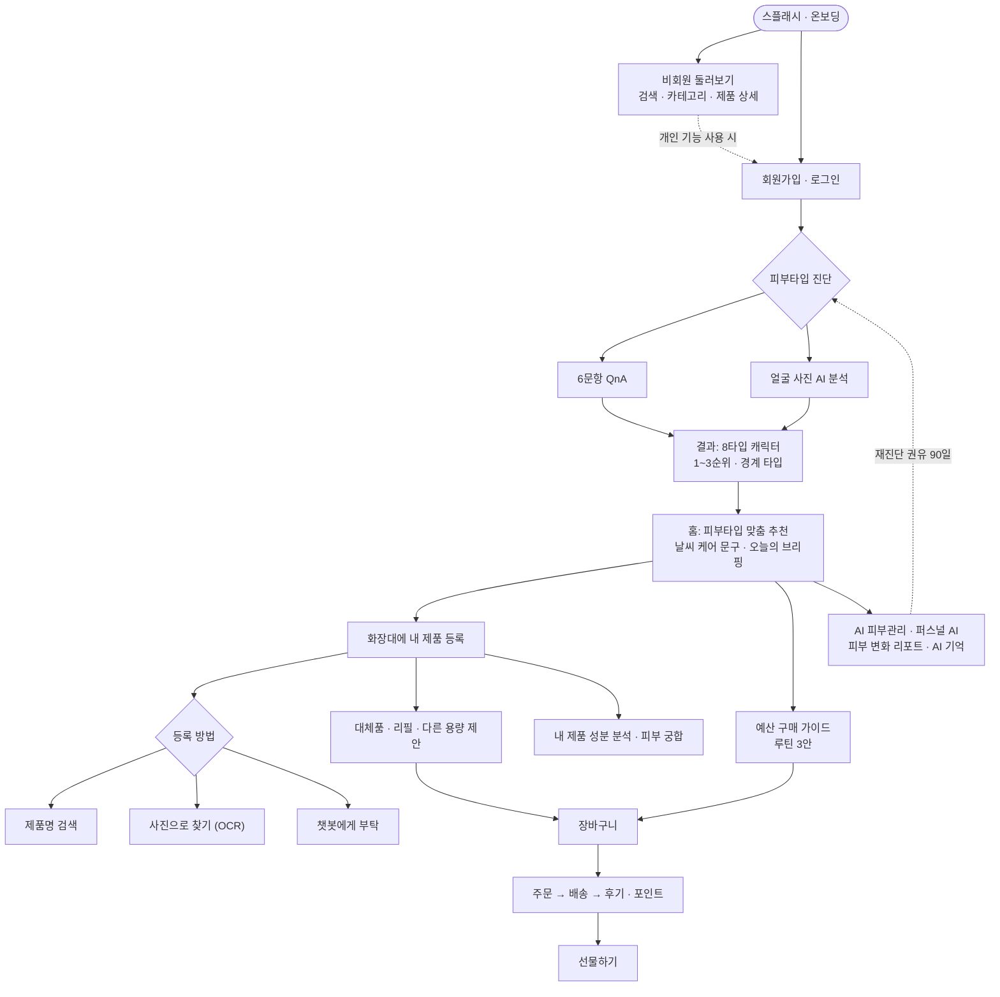
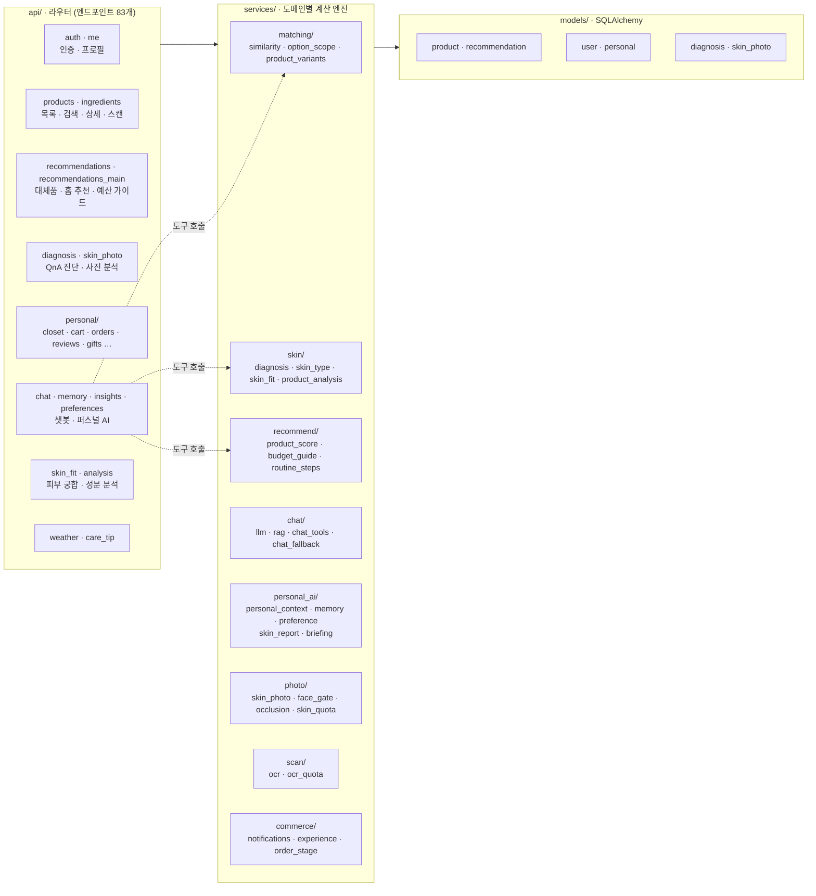
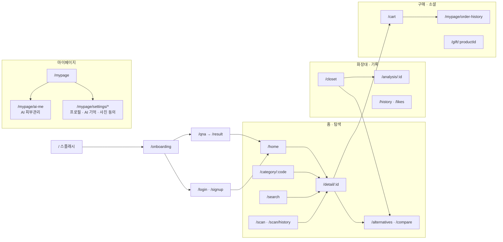
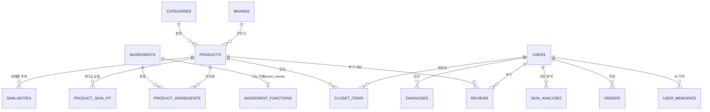

# swappy 🌿

[](https://github.com/EunSeong-Jo/capstone/actions/workflows/backend-tests.yml)

> **AI 기반 피부타입 맞춤 제품 추천 · 성분 유사도 대체품 매칭 서비스**

피부타입 진단(6문항 QnA 또는 얼굴 사진)으로 **8가지 피부 캐릭터** 중 하나를 정하고, 그 피부에 맞는 화장품을 추천합니다.
내가 쓰는 제품을 **화장대**에 올리면 **전성분만 보고** 성분이 비슷하면서 더 싸거나 더 잘 맞는 대체품을 찾아 주고,
예산을 입력하면 토너·에센스·크림·선크림 루틴 조합을 제안합니다. 챗봇은 내 피부·화장대·취향을 알고, 우리 계산 엔진을 도구로 불러 답합니다.

| 제품 | 성분 | 제품–성분 연결 | 유사도 | API | 화면 |
|---:|---:|---:|---:|---:|---:|
| **4,013** | **23,147** | **163,103** | **146,940** | **83**개 | **46**개 |

> 이 문서는 프로젝트의 **입구**입니다. 그림으로 전체를 보여 주고, 자세한 내용은 [문서 지도](#-문서-지도)의 링크로 안내합니다.
> 숫자는 2026-10-31 `main` 기준이며, 값이 다르면 링크된 정본 문서([docs/architecture/db-schema.md](docs/architecture/db-schema.md), [docs/algorithms/ai-and-scoring-logic.md](docs/algorithms/ai-and-scoring-logic.md))가 맞습니다.

---

## 목차

1. [핵심 기능](#-핵심-기능)
2. [시스템 구성도](#-시스템-구성도)
3. [프로세스 흐름도](#-프로세스-흐름도)
   - [데이터 수집·적재](#31-데이터-수집적재)
   - [대체품 추천 요청](#32-대체품-추천-요청)
   - [얼굴 사진 AI 분석](#33-얼굴-사진-ai-분석)
   - [챗봇 도구 호출](#34-챗봇-도구-호출)
4. [사용자 시나리오 구성도](#-사용자-시나리오-구성도)
5. [상세 구성도](#-상세-구성도)
   - [백엔드 계층](#51-백엔드-계층)
   - [프론트엔드 화면](#52-프론트엔드-화면)
   - [데이터 모델](#53-데이터-모델)
6. [기술 스택](#-기술-스택)
7. [빠른 시작](#-빠른-시작)
8. [테스트](#-테스트)
9. [프로젝트 구조](#-프로젝트-구조)
10. [피부타입 캐릭터](#-피부타입-캐릭터-8종)
11. [문서 지도](#-문서-지도)
12. [팀 · 라이선스](#-팀--라이선스)

---

## ✨ 핵심 기능

| 기능 | 한 줄 설명 | 자세히 |
|---|---|---|
| **피부타입 진단** | 5축(수분·유분·민감·색소·트러블) 점수 → 8타입과의 거리로 1~3순위, 경계 타입 안내 | [점수 로직 §3](docs/algorithms/ai-and-scoring-logic.md#3-피부타입-진단-qna) |
| **얼굴 사진 AI 분석** | 서버 사전 검증(YuNet·MediaPipe) → Perfect Corp 분석 → 5축 변환 → QnA와 혼합 | [점수 로직 §4](docs/algorithms/ai-and-scoring-logic.md#4-얼굴-사진-ai-분석) |
| **성분 유사도 · 대체품** | 역할 가중 TF-IDF + 기능 프로필 + 제형 일치(`hybrid`), 같은 카테고리 안에서만 비교 | [점수 로직 §5](docs/algorithms/ai-and-scoring-logic.md#5-성분-유사도--대체품-추천-servicesmatchingsimilaritypy) · [유사도 엔진](docs/algorithms/similarity.md) |
| **피부 궁합** | 성분 기능 라벨 × 타입별 선호·기피 → 0~100점, `good`/`ok`/`caution`/`unknown` | [점수 로직 §6](docs/algorithms/ai-and-scoring-logic.md#6-피부-궁합--성분-분석-servicesskinskin_fitpy--점수-로직의-핵심) |
| **홈 추천 · 예산 가이드** | 궁합·별점·리뷰수·브랜드 다양성 가중합, 예산 안의 루틴 조합을 전부 탐색해 3안 제시 | [점수 로직 §7](docs/algorithms/ai-and-scoring-logic.md#7-추천--예산-가이드) |
| **챗봇** | RAG + 도구 호출(계산 엔진 10종), LLM이 모두 실패해도 DB 규칙으로 답함 | [점수 로직 §8-1](docs/algorithms/ai-and-scoring-logic.md#8-1-챗봇-apichatpy-serviceschatragpy) |
| **퍼스널 AI** | AI 기억 · 내 성분 취향 · 피부 변화 리포트 · 오늘의 브리핑 | [점수 로직 §8-6](docs/algorithms/ai-and-scoring-logic.md#8-6-퍼스널-ai-serviceschatchat_toolspy-memorypy-preferencepy-skin_reportpy-briefingpy-personal_contextpy) |
| **사진으로 제품 찾기** | CLOVA OCR → `pg_trgm` 제품명 대조 → 후보 3개 + "찾는 제품이 없어요" | [점수 로직 §8-3](docs/algorithms/ai-and-scoring-logic.md#8-3-사진으로-제품-찾기-servicesscanocrpy-apiproductspy) · [OCR 벤치마크](research/ocr/OCR_SUMMARY.md) |
| **쇼핑 · 기록** | 화장대·장바구니·찜·주문·취소·반품·후기·포인트·선물·알림 | [기능 카탈로그](docs/architecture/PROJECT_OVERVIEW.md#5-기능-카탈로그-화면별) |

> **대체품·궁합·추천·예산 가이드·취향은 학습한 ML 모델이 아니라 규칙·통계식**입니다(TF-IDF 코사인, 가중합, 지수 포화).
> 모든 점수를 **성분 이름으로 설명**할 수 있게 설계했습니다. 사용한 AI·외부 모델 전체 목록은 [점수 로직 §1](docs/algorithms/ai-and-scoring-logic.md#1-한눈에--사용한-ai외부-모델)에 있습니다.

---

## 🏗 시스템 구성도

하나의 React 번들을 웹과 Android 앱(Capacitor)이 함께 씁니다. 운영 서버는 FastAPI가 API와 프론트 빌드 결과를 **한 주소에서** 서빙합니다.



- 운영 이미지는 [`Dockerfile.prod`](Dockerfile.prod) 하나입니다. Node로 프론트를 빌드한 뒤 Python 3.11 이미지에 백엔드와 함께 얹습니다.
- 파일은 디스크에 저장하지 않습니다. 후기 사진·분석 이미지는 DB에 바이트로 저장합니다.
- **외부 키가 없어도 서버는 뜹니다.** LLM이 없으면 챗봇은 규칙 폴백으로, OCR이 없으면 제품명 검색으로 안내합니다.
- 배포 절차는 [프로젝트 총정리 §11](docs/architecture/PROJECT_OVERVIEW.md#11-배포운영데모), 운영 DB 이전은 [docs/guides/aws-db-migration.md](docs/guides/aws-db-migration.md)에 있습니다.

---

## 🔄 프로세스 흐름도

### 3.1 데이터 수집·적재

제품과 성분 데이터는 미리 수집·정제해 DB에 넣고, 무거운 계산(유사도·궁합)은 **배치로 미리** 해 둡니다. 모든 단계는 멱등이라 다시 돌려도 안전합니다.



스크립트는 모두 `backend/pipeline/` 아래에 단계별로 있고, `backend/` 안에서 `python pipeline/load/load_products.py`처럼 실행합니다.

자세히: [DB 스키마 · 적재 파이프라인](docs/architecture/db-schema.md#적재-파이프라인) · [점수 로직 §11](docs/algorithms/ai-and-scoring-logic.md#11-데이터-수집적재-파이프라인)

### 3.2 대체품 추천 요청

화면에서 대체품을 열면 **미리 계산한 유사도를 읽기만** 합니다. 그래서 응답이 빠르고, 같은 제품은 Redis에서 바로 나갑니다.



### 3.3 얼굴 사진 AI 분석

부적합한 사진은 **외부로 보내기 전에** 서버에서 거르고, 위치 정보(EXIF)를 지운 사진만 분석 업체로 보냅니다. 원본 사진은 보관하지 않습니다.



무료는 월 1회·8항목, 구독은 월 4회·16항목입니다. 자세히: [점수 로직 §4](docs/algorithms/ai-and-scoring-logic.md#4-얼굴-사진-ai-분석) · [백엔드 README](backend/README.md#얼굴-사진-ai-분석-perfect-corp)

### 3.4 챗봇 도구 호출

로그인한 사용자의 챗봇은 **사실을 직접 만들지 않고** 우리 계산 엔진을 불러 결과를 문장으로 옮깁니다. 담기·추가는 *제안*만 하고, 실제 실행은 사용자가 버튼을 눌러야 일어납니다.



도구 10종과 안전 규칙은 [점수 로직 §8-6](docs/algorithms/ai-and-scoring-logic.md#8-6-퍼스널-ai-serviceschatchat_toolspy-memorypy-preferencepy-skin_reportpy-briefingpy-personal_contextpy)에 있습니다.

---

## 🧭 사용자 시나리오 구성도

비회원도 진단까지 해 볼 수 있고(Soft-gate), 개인 데이터를 저장할 때부터 로그인합니다.



- 시연용 단계별 워크스루(페르소나 5명 · 데모 계정 · 구간 1~6): [docs/guides/demo-scenario.md](docs/guides/demo-scenario.md)
- 화면별 기능 목록: [프로젝트 총정리 §5](docs/architecture/PROJECT_OVERVIEW.md#5-기능-카탈로그-화면별)
- 사용자 페르소나: [프로젝트 총정리 §1.4](docs/architecture/PROJECT_OVERVIEW.md#14-사용자-페르소나-prd-v18) · [PRD v1.8](docs/product/PRD_swappy_v1.8.md)

---

## 🧩 상세 구성도

### 5.1 백엔드 계층

라우터는 요청 검증과 응답만 맡고, 계산은 모두 `services/`에 있습니다. 같은 서비스를 화면 API와 챗봇 도구가 함께 씁니다.



| 계층 | 위치 | 문서 |
|---|---|---|
| 라우터 · API 목록 | `backend/app/api/` · Swagger `/api/docs` | [프로젝트 총정리 §6](docs/architecture/PROJECT_OVERVIEW.md#6-백엔드-api) · [점수 로직 §2](docs/algorithms/ai-and-scoring-logic.md#2-기능-목록-백엔드-api-기준) |
| 서비스(계산 엔진) | `backend/app/services/` | [docs/algorithms/ai-and-scoring-logic.md](docs/algorithms/ai-and-scoring-logic.md) |
| 모델 · 마이그레이션 | `backend/app/models/` · `backend/alembic/versions/` | [docs/architecture/db-schema.md](docs/architecture/db-schema.md) · [백엔드 README · Alembic](backend/README.md#alembic) |

### 5.2 프론트엔드 화면

화면 라우트 46개를 영역별로 묶은 지도입니다. 하단 내비게이션은 홈 · 카테고리 · 검색 · 화장대 · 마이입니다.



- 화면 규격 · 컨벤션 · 목업 금지 규칙: [frontend/README.md](frontend/README.md#7-1-화면-규격-표준--2026-07-ui-통일에서-확정)
- 컴포넌트 카탈로그 · 디자인 토큰: [docs/guides/frontend-component-guide.md](docs/guides/frontend-component-guide.md) · [docs/guides/dev_guidelines.md](docs/guides/dev_guidelines.md)
- 전체 라우트 정의: [`frontend/src/App.tsx`](frontend/src/App.tsx)

### 5.3 데이터 모델

테이블 38개를 도메인으로 묶으면 다음과 같습니다. 컬럼 · 인덱스 · 행수는 정본 문서에 있습니다.



> 위 그림은 38개 중 대표 테이블만 고른 것입니다. 실제 테이블 이름과 전체 관계도는 [docs/architecture/db-schema.md](docs/architecture/db-schema.md#관계도)를 보세요.

---

## 🛠 기술 스택

| 영역 | 기술 |
|---|---|
| **Frontend** | React 18 · TypeScript · Vite · Tailwind CSS · **Capacitor**(Android 앱) · MediaPipe Tasks Vision(촬영 전 얼굴 확인) |
| **Backend** | Python 3.11 · FastAPI(비동기) · SQLAlchemy 2.0 · Alembic · structlog · Sentry |
| **Database** | PostgreSQL 16 + `pg_trgm` · Redis 7(캐시 · 일일 한도) |
| **수치 계산** | numpy + scipy 희소행렬(TF-IDF 코사인 직접 구현, scikit-learn 미사용) |
| **LLM** | OpenAI `gpt-4o-mini` → Anthropic `claude-haiku-5-5` → DB 규칙 폴백 |
| **외부 API** | 네이버 CLOVA OCR · Perfect Corp YouCam(피부 분석) · OpenWeather |
| **이미지 처리** | Pillow(EXIF 제거) · OpenCV YuNet(얼굴 검출) · MediaPipe(가림 검사) |
| **인프라** | Docker Compose(로컬) · AWS Lightsail 컨테이너 + DB(운영) · Neon(개발) |

---

## 🚀 빠른 시작

> **Windows에서 설치 없이 보려면**: `git clone` 후 `Swappy.bat`만 실행하면 서버와 앱 창이 뜹니다 → [docs/guides/로컬실행.md](docs/guides/로컬실행.md)

```bash
git clone https://github.com/EunSeong-Jo/capstone.git
cd capstone

cp .env.example .env
#  .env의 DATABASE_DSN에 Neon 연결 문자열을 넣습니다. (필수 · Neon 조직 dmu 초대 필요)
#  선택: OPENAI_API_KEY / ANTHROPIC_API_KEY(챗봇), CLOVA_OCR_*(사진으로 찾기), PERFECT_CORP_*(피부 분석)

docker compose up --build
```

| 서비스 | URL |
|--------|-----|
| 프론트엔드 | http://localhost:3000 |
| 백엔드 API | http://localhost:8000/health |
| Swagger 문서 | http://localhost:8000/api/docs |

<details>
<summary>Docker 없이 / 로컬 PostgreSQL로 돌리기</summary>

```bash
# 터미널 1 — 백엔드
cd backend && uvicorn app.main:app --reload
# 터미널 2 — 프론트엔드 (프록시 대상을 지정해야 합니다)
cd frontend && VITE_API_BASE_URL=http://127.0.0.1:8000 npm run dev

# 로컬 DB가 필요하면 (빈 DB라 스키마·데이터를 직접 넣어야 합니다)
docker compose --profile local-db up
cd backend && alembic upgrade head
python backend/pipeline/load/seed_ingredients.py && python backend/pipeline/load/load_products.py
```

Neon 덤프를 로컬로 복원하는 방법은 [백엔드 README · 로컬 DB로 개발하기](backend/README.md#로컬-db로-개발하기-neon-cu-hrs를-쓰지-않기)에 있습니다.

</details>

| 하려는 일 | 문서 |
|---|---|
| 백엔드 세팅 · 마이그레이션 · 테스트 | [backend/README.md](backend/README.md) |
| 프론트 세팅 · 화면 규격 · APK 빌드 | [frontend/README.md](frontend/README.md) |
| 브랜치 · PR · 공용 DB 주의사항 | [CLAUDE.md](CLAUDE.md#작업-규칙) |

---

## ✅ 테스트

백엔드 테스트 **787건**을 DB가 필요한지에 따라 두 폴더로 나눴습니다.

| 폴더 | 무엇을 검증하나 | 필요한 것 | 건수 | 실행 |
|---|---|---|---:|---|
| [`backend/tests/unit`](backend/tests/unit) | 유사도·궁합·진단 점수, 전성분 파싱, 예산 조합, 챗봇 도구·폴백 규칙(LLM은 가짜) | Python만 | 474 | **GitHub Actions가 푸시·PR마다** |
| [`backend/tests/integration`](backend/tests/integration) | API 응답 계약, DB 조회·쓰기, 이용 한도(Redis) | 데이터가 적재된 Postgres + Redis | 313 | 로컬 Postgres |

```bash
cd backend && pytest tests/unit                               # DB 없이 약 3초
docker exec swappy_backend python -m pytest                   # 전부 (로컬 Postgres)
```

나눈 기준은 짐작이 아니라 실측입니다. DB·Redis 접속을 끊고 전체를 돌렸을 때 통과한 테스트가 unit입니다. 자세히: [백엔드 README · 테스트](backend/README.md#테스트)

---

## 📁 프로젝트 구조

```
capstone/
├── backend/
│   ├── app/                 # ── 서버 런타임 ──
│   │   ├── api/             #   라우터 (엔드포인트 83개, 개인 데이터는 personal/ 패키지)
│   │   ├── services/        #   계산 엔진 — matching · skin · recommend · chat · personal_ai · photo · scan · commerce
│   │   ├── models/          #   SQLAlchemy 모델 — DB 스키마 원본
│   │   ├── schemas/         #   Pydantic 입출력
│   │   └── core/ db/ utils/ assets/
│   ├── pipeline/            # ── DB를 만드는 오프라인 스크립트 ──
│   │   ├── collect/         #   수집 · 성분 사전 추출
│   │   ├── load/            #   적재 · 시드
│   │   ├── batch/           #   유사도 · 궁합 사전 계산
│   │   └── maintenance/     #   정비 · 진단 리포트
│   ├── alembic/versions/    # 마이그레이션
│   └── tests/               # pytest — unit(DB 불필요, CI) · integration(DB 필요)
├── frontend/                # React + Capacitor (Android) — src/ pages · components · hooks · api · context
├── data/                    # raw(수집 CSV) · seed(성분 사전·기능 라벨) · eval(평가 정답셋) · ocr_test(실사진)
├── research/                # 끝난 실험과 측정 — eval(평가 스위트) · image-match · ocr(엔진 벤치마크)
├── tools/                   # demo(시연 시드) · ops(AWS DB · DB 초기화) · standalone(Windows 단독 실행)
├── docs/                    # architecture · algorithms · guides · product · design · deliverables → docs/README.md
├── Swappy.bat               # Windows 단독 실행 진입점
├── Dockerfile.prod          # 운영 이미지 (프론트 빌드 + 백엔드)
├── .github/workflows/       # CI — 백엔드 unit 테스트
└── docker-compose.yml       # 로컬 개발
```

| 폴더 | 원칙 |
|---|---|
| `backend/app` | 서버가 import하는 코드만 둡니다 |
| `backend/pipeline` | DB를 만드는 반복 실행 스크립트입니다. 서버는 import하지 않습니다 |
| `research` | 결론이 난 실험과 측정입니다. 운영 코드가 여기를 참조하지 않습니다 |
| `tools` | 사람이 손으로 돌리는 시연 · 운영 도구입니다 |
| `docs` | 주제마다 정본이 하나입니다 — [docs/README.md](docs/README.md) |

---

## 🎭 피부타입 캐릭터 (8종)

| 캐릭터 | 특성 | 추천 성분 방향 |
|--------|------|---------------|
| 수분팡팡 옹달샘 | 수분·유분 균형 (이상적 피부) | 가벼운 보습 유지 |
| 반질반질 물개 | 지성, 번들거림, 모공 | 살리실산, 논코메도제닉 |
| 겉바속촉 수부지 | 속건조 + 겉번들 | 히알루론산 + 가벼운 유분 조절 |
| 울긋불긋 화산 | 트러블·홍조·염증 | 시카, 판테놀, 진정 성분 |
| 바스락 사막 | 극건성, 당김 강함 | 세라마이드, 시어버터, 고보습 |
| 말랑말랑 인절미 | 건성·탄력 저하, 주름 | 레티놀, 펩타이드, 콜라겐 |
| 조심조심 유리구슬 | 민감성, 자극에 즉각 반응 | 저자극 인증, 무향, 무알코올 |
| 얼룩덜룩 메밀묵 | 색소침착·잡티·톤 불균형 | 나이아신아마이드, 비타민C |

타입별 5축 프로필과 선호·기피 성분 가중치는 [점수 로직 §3-2](docs/algorithms/ai-and-scoring-logic.md#3-2-8타입-프로필-코드-상수) · [§6-2](docs/algorithms/ai-and-scoring-logic.md#6-2-타입별-선호-기능-가중-prefer)에 있습니다.

---

## 📚 문서 지도

**처음 본다면** → [프로젝트 총정리](docs/architecture/PROJECT_OVERVIEW.md) → [점수 로직 총정리](docs/algorithms/ai-and-scoring-logic.md) → [데모 시나리오](docs/guides/demo-scenario.md) 순서를 추천합니다.

| 분류 | 문서 | 내용 |
|---|---|---|
| **색인** | [docs/README.md](docs/README.md) | 문서 폴더 안내 · 주제별 정본 목록 |
| **개요** | [docs/architecture/PROJECT_OVERVIEW.md](docs/architecture/PROJECT_OVERVIEW.md) | 프로젝트 총정리 — 구조, 기능 카탈로그, 고민과 결정 기록, 타임라인 |
| | [docs/product/PRD_swappy_v1.8.md](docs/product/PRD_swappy_v1.8.md) | 제품 요구사항 (§7.9 스키마는 설계 시점 안이라 실제와 다름) |
| **AI · 알고리즘** | [docs/algorithms/ai-and-scoring-logic.md](docs/algorithms/ai-and-scoring-logic.md) | AI · 점수 로직 총정리 (가중치·임계값 전체) |
| | [docs/algorithms/similarity.md](docs/algorithms/similarity.md) | 성분 유사도 엔진과 평가 (nDCG@10 0.799) |
| | [research/ocr/OCR_SUMMARY.md](research/ocr/OCR_SUMMARY.md) · [research/image-match/IMAGE_MATCH_SUMMARY.md](research/image-match/IMAGE_MATCH_SUMMARY.md) | OCR 엔진 벤치마크 · 이미지 유사도 측정 |
| **데이터** | [docs/architecture/db-schema.md](docs/architecture/db-schema.md) | **DB 스키마 정본** — 테이블 38개, 인덱스, 적재 파이프라인 |
| **시나리오 · 시연** | [docs/guides/demo-scenario.md](docs/guides/demo-scenario.md) | 단계별 데모 워크스루 · 데모 계정 · 시연 전 한계 |
| | [docs/guides/로컬실행.md](docs/guides/로컬실행.md) | Windows 단독 실행 (`Swappy.bat`) |
| **개발** | [backend/README.md](backend/README.md) | 백엔드 세팅 · Alembic · Neon 주의사항 · 테스트 |
| | [frontend/README.md](frontend/README.md) | 프론트 기준 · 화면 규격 · APK 빌드 · 협업 규칙 |
| | [docs/guides/frontend-component-guide.md](docs/guides/frontend-component-guide.md) | 컴포넌트 카탈로그 · 디자인 토큰 |
| | [docs/guides/dev_guidelines.md](docs/guides/dev_guidelines.md) | 디자인 시스템 · 화면별 체크리스트 |
| | [CLAUDE.md](CLAUDE.md) | 현황 · 태스크 · 작업 규칙(브랜치·마이그레이션·공용 DB) |
| **운영** | [docs/guides/aws-db-migration.md](docs/guides/aws-db-migration.md) | 운영 DB(AWS) 생성 · 덤프 · 복원 |
| | [프로젝트 총정리 §11](docs/architecture/PROJECT_OVERVIEW.md#11-배포운영데모) | 배포 절차 (Lightsail 컨테이너) |

---

## 👥 팀 · 라이선스

| 이름 | 역할 |
|---|---|
| 조은성 | 팀장 · 프론트 통합 |
| 최동균 | 부팀장 · 상품 데이터 · DB |
| 박주원 | 편집 · 백엔드 · RAG 챗봇 |
| 심유빈 | 학술 · OCR · UI |
| 김미송 | 총무 · UI/UX · 피부진단 |

이 저장소의 모든 내용은 저작권자 5인의 공동 저작물이며 **All Rights Reserved**입니다.
사전 서면 허락 없이 복제 · 수정 · 배포 · 이용할 수 없습니다 → [LICENSE](LICENSE)
