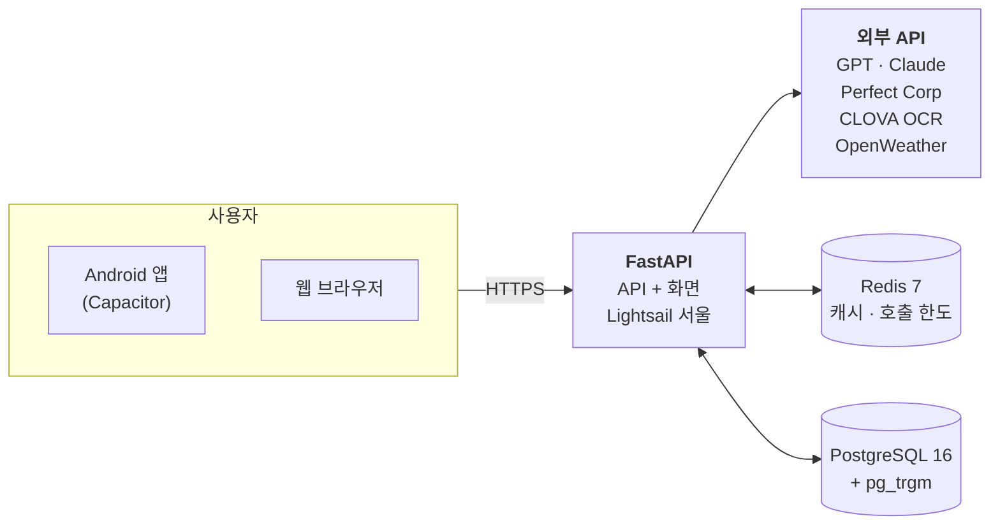

# swappy 🌿

[](https://github.com/EunSeong-Jo/capstone/actions/workflows/backend-tests.yml)

> **AI 기반 피부타입 맞춤 제품 추천 · 성분 유사도 대체품 매칭 서비스**

피부타입 진단(6문항 QnA 또는 얼굴 사진)으로 **8가지 피부 캐릭터** 중 하나를 정하고, 그 피부에 맞는 화장품을 추천합니다. 내가 쓰는 제품을 **화장대**에 올리면 **전성분만 보고** 더 싸거나 더 잘 맞는 대체품을 찾아 주고, 예산을 입력하면 루틴 조합을 제안합니다. 챗봇은 내 피부·화장대·취향을 알고, 우리 계산 엔진을 도구로 불러 답합니다.

| 제품 | 성분 | 제품–성분 연결 | 유사도 | API | 화면 | 테스트 |
|---:|---:|---:|---:|---:|---:|---:|
| **4,402** | **23,150** | **178,758** | **105,620** | **87** | **46** | **788** |

<sub>2026-11-24 실측 · DB 테이블 38개 · 제품은 DB 행 기준(용량·구성 변형을 접은 목록은 2,579개) · 값이 다르면 [DB 스키마](docs/architecture/db-schema.md)가 정본</sub>

**목차** — [핵심 기능](#-핵심-기능) · [시스템 구성도](#-시스템-구성도) · [기술 스택](#-기술-스택) · [빠른 시작](#-빠른-시작) · [프로젝트 구조](#-프로젝트-구조) · [문서](#-문서) · [팀 · 라이선스](#-팀--라이선스)

---

## ✨ 핵심 기능

| 기능 | 한 줄 설명 |
|---|---|
| [**피부타입 진단**](docs/algorithms/ai-and-scoring-logic.md#3-피부타입-진단-qna) | 5축(수분·유분·민감·색소·트러블) 점수 → 8타입과의 거리로 1~3순위, 경계 타입 안내 |
| [**얼굴 사진 AI 분석**](docs/algorithms/ai-and-scoring-logic.md#4-얼굴-사진-ai-분석) | 서버 사전 검증(YuNet·MediaPipe) → Perfect Corp 분석 → 5축 변환 → QnA와 혼합 |
| [**유사도 · 대체품**](docs/algorithms/similarity.md) | 역할 가중 TF-IDF + 기능 프로필 + 제형 일치(`hybrid`), 같은 카테고리 안에서만 비교 |
| [**피부 궁합**](docs/algorithms/ai-and-scoring-logic.md#6-피부-궁합--성분-분석-servicesskinskin_fitpy--점수-로직의-핵심) | 성분 기능 라벨 × 타입별 선호·기피 → 0~100점 |
| [**추천 · 예산**](docs/algorithms/ai-and-scoring-logic.md#7-추천--예산-가이드) | 궁합·별점·리뷰수 가중합, 예산 안의 루틴 조합을 전부 탐색해 3안 제시 |
| [**챗봇 · 퍼스널 AI**](docs/algorithms/ai-and-scoring-logic.md#8-1-챗봇-apichatpy-serviceschatragpy) | RAG + 도구 호출(계산 엔진 10종) · AI 기억 · 성분 취향 · 오늘의 브리핑 |
| [**사진으로 제품 찾기**](research/ocr/OCR_SUMMARY.md) | CLOVA OCR로 읽은 글자 → 제품명 대조 → 후보 3개 제시 |
| [**쇼핑 · 기록**](docs/architecture/PROJECT_OVERVIEW.md#5-기능-카탈로그-화면별) | 화장대·장바구니·찜·주문·취소·반품·후기·포인트·선물·알림 |

> 대체품·궁합·추천은 학습한 ML 모델이 아니라 **규칙·통계식**이라, 모든 점수를 **성분 이름으로 설명**할 수 있습니다.

---

## 🏗 시스템 구성도

하나의 React 번들을 웹과 Android 앱(Capacitor)이 함께 쓰고, 운영 서버는 FastAPI가 API와 화면을 **한 주소에서** 서빙합니다.



외부 키가 없어도 서버는 뜹니다 — LLM이 없으면 챗봇은 DB 규칙으로, OCR이 없으면 제품명 검색으로 안내합니다.

**더 자세한 그림** — [구성도 모음](docs/architecture/diagrams.md)

- **흐름도** · [데이터 수집·적재](docs/architecture/diagrams.md#11-데이터-수집적재) · [대체품 추천](docs/architecture/diagrams.md#12-대체품-추천-요청) · [얼굴 사진 분석](docs/architecture/diagrams.md#13-얼굴-사진-ai-분석) · [챗봇 도구 호출](docs/architecture/diagrams.md#14-챗봇-도구-호출)
- **시나리오** · [가입부터 주문까지](docs/architecture/diagrams.md#2-사용자-시나리오-구성도)
- **상세 구성도** · [백엔드 계층](docs/architecture/diagrams.md#31-백엔드-계층) · [프론트 화면](docs/architecture/diagrams.md#32-프론트엔드-화면) · [데이터 모델](docs/architecture/diagrams.md#33-데이터-모델)

---

## 🛠 기술 스택

| 영역 | 기술 |
|---|---|
| **Frontend** | React 18 · TypeScript · Vite · Tailwind CSS · Capacitor(Android) · MediaPipe |
| **Backend** | Python 3.11 · FastAPI · SQLAlchemy 2.0 · Alembic |
| **Data** | PostgreSQL 16 + `pg_trgm` · Redis 7 · numpy/scipy(TF-IDF 직접 구현) |
| **AI · 외부** | OpenAI → Claude · CLOVA OCR · Perfect Corp · OpenWeather · YuNet |
| **Infra** | Docker Compose · AWS Lightsail · Neon · GitHub Actions |

---

## 🚀 빠른 시작

```bash
git clone https://github.com/EunSeong-Jo/capstone.git && cd capstone
cp .env.example .env      # DATABASE_DSN 필수 · LLM·OCR·피부 분석 키는 선택
docker compose up --build
```

프론트 http://localhost:3000 · API http://localhost:8000/health · Swagger http://localhost:8000/api/docs

- **Windows에서 설치 없이** → `Swappy.bat` 실행 ([로컬실행 가이드](docs/guides/로컬실행.md))
- **Docker 없이 · 로컬 DB로** → [백엔드 README](backend/README.md) · [프론트 README](frontend/README.md)
- **테스트** → `cd backend && pytest tests/unit` (DB 없이 약 3초, CI가 푸시·PR마다 실행) · DB가 필요한 테스트는 [백엔드 README](backend/README.md#테스트)

---

## 📁 프로젝트 구조

```
capstone/
├── backend/
│   ├── app/          # 서버 런타임 — api · services(계산 엔진) · models(DB 스키마)
│   ├── pipeline/     # DB를 만드는 스크립트 — collect · load · batch · maintenance
│   ├── alembic/      # 마이그레이션
│   └── tests/        # unit(DB 불필요 · CI) · integration(DB 필요)
├── frontend/         # React + Capacitor(Android)
├── data/             # 수집 CSV · 시드 · 평가 정답셋
├── research/         # 끝난 실험과 측정 — 평가 · OCR · 이미지 매칭
├── tools/            # 시연 · 운영 · Windows 단독 실행 도구
└── docs/             # 문서 (색인: docs/README.md)
```

<details>
<summary>🎭 피부타입 캐릭터 8종</summary>

| 캐릭터 | 특성 | 추천 성분 방향 |
|--------|------|---------------|
| 수분팡팡 옹달샘 | 수분·유분 균형 (이상적 피부) | 가벼운 보습 유지 |
| 반질반질 물개 | 지성, 번들거림, 모공 | 살리실산, 논코메도제닉 |
| 겉바속촉 수부지 | 속건조 + 겉번들 | 히알루론산 + 가벼운 유분 조절 |
| 울긋불긋 화산 | 트러블·홍조·염증 | 시카, 판테놀, 진정 성분 |
| 바스락 사막 | 극건성, 당김 강함 | 세라마이드, 시어버터, 고보습 |
| 말랑말랑 인절미 | 건성·탄력 저하, 주름 | 레티놀, 펩타이드, 콜라겐 |
| 조심조심 유리구슬 | 민감성, 자극에 즉각 반응 | 저자극 인증, 무향, 무알코올 |
| 얼룩덜룩 메밀묵 | 색소침착·잡티·톤 불균형 | 나이아신아마이드, 비타민C |

타입별 프로필과 성분 가중치: [점수 로직 §3-2](docs/algorithms/ai-and-scoring-logic.md#3-2-8타입-프로필-코드-상수)

</details>

---

## 📚 문서

처음 본다면 **[프로젝트 총정리](docs/architecture/PROJECT_OVERVIEW.md) → [점수 로직](docs/algorithms/ai-and-scoring-logic.md) → [데모 시나리오](docs/guides/demo-scenario.md)** 순서를 추천합니다.

| 분류 | 문서 |
|---|---|
| 개요 | [프로젝트 총정리](docs/architecture/PROJECT_OVERVIEW.md) · [구성도 모음](docs/architecture/diagrams.md) · [PRD v1.8](docs/product/PRD_swappy_v1.8.md) |
| AI · 알고리즘 | [점수 로직 총정리](docs/algorithms/ai-and-scoring-logic.md) · [성분 유사도 엔진](docs/algorithms/similarity.md) · [OCR 벤치마크](research/ocr/OCR_SUMMARY.md) |
| 데이터 | [DB 스키마 정본](docs/architecture/db-schema.md) |
| 개발 · 운영 | [백엔드](backend/README.md) · [프론트엔드](frontend/README.md) · [운영 DB](docs/guides/aws-db-migration.md) · [작업 규칙](CLAUDE.md#작업-규칙) |
| 전체 색인 | [docs/README.md](docs/README.md) |

---

## 👥 팀 · 라이선스

| 조은성 | 최동균 | 박주원 | 심유빈 | 김미송 |
|:---:|:---:|:---:|:---:|:---:|
| 팀장<br>프론트 통합 | 부팀장<br>상품 데이터 · DB | 편집<br>백엔드 · RAG 챗봇 | 학술<br>OCR · UI | 총무<br>UI/UX · 피부진단 |

저작권자 5인의 공동 저작물이며 **All Rights Reserved**입니다. 사전 서면 허락 없이 복제 · 수정 · 배포 · 이용할 수 없습니다 → [LICENSE](LICENSE)
