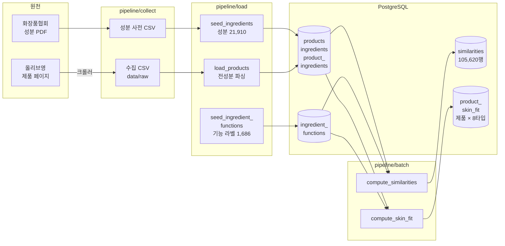
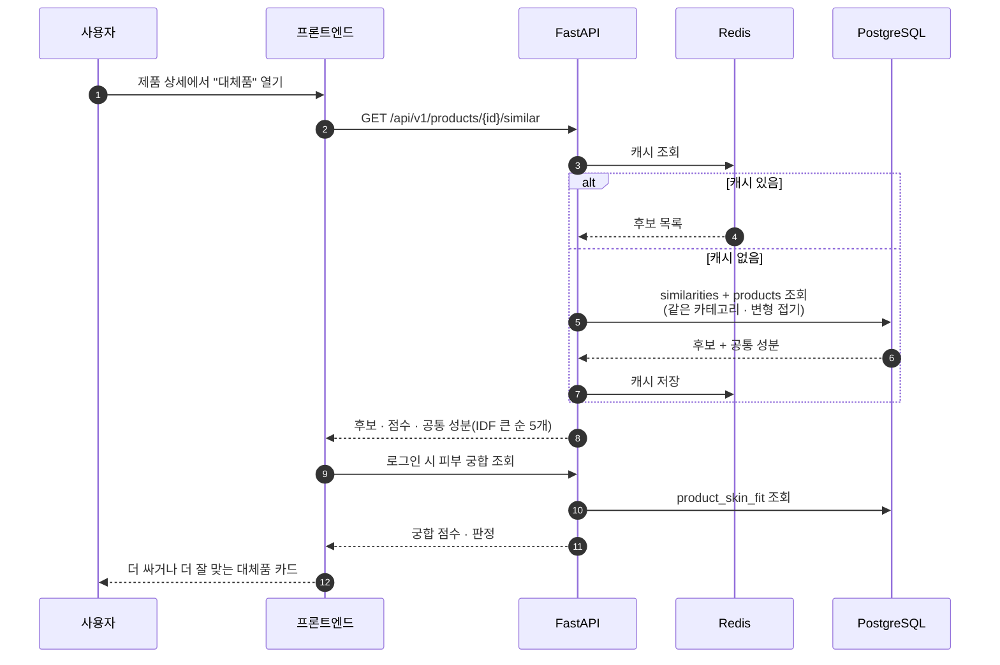
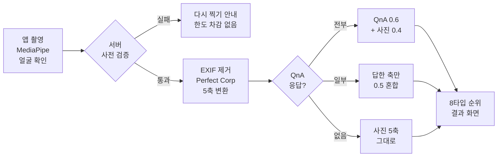
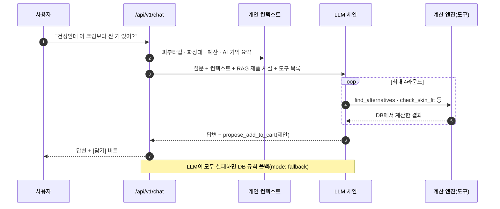
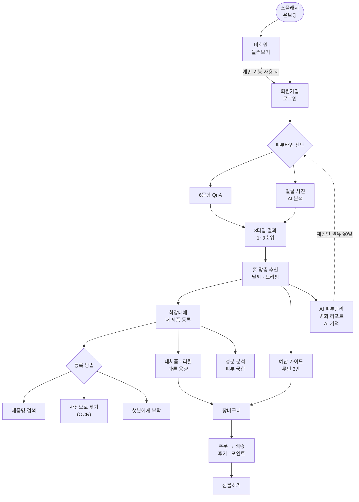
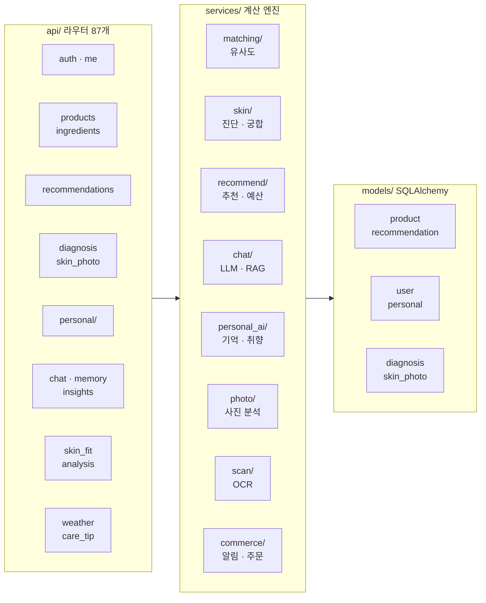
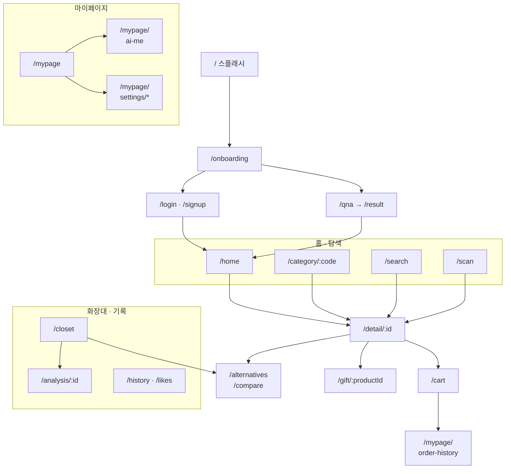
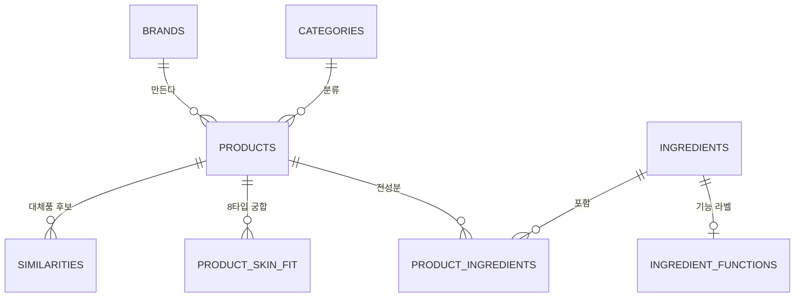
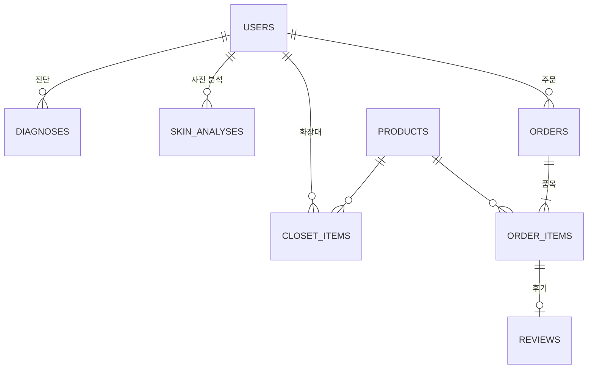

# swappy 구성도 모음

[README](../../README.md)에는 시스템 구성도만 두고, 나머지 그림은 여기에 모았습니다.
숫자는 2026-11-24 DB 실측값입니다. 값이 다르면 [DB 스키마](db-schema.md)가 정본입니다.

| 구분 | 그림 |
|---|---|
| 프로세스 흐름도 | [1.1 데이터 수집·적재](#11-데이터-수집적재) · [1.2 대체품 추천 요청](#12-대체품-추천-요청) · [1.3 얼굴 사진 AI 분석](#13-얼굴-사진-ai-분석) · [1.4 챗봇 도구 호출](#14-챗봇-도구-호출) |
| 사용자 시나리오 | [2. 사용자 시나리오 구성도](#2-사용자-시나리오-구성도) |
| 상세 구성도 | [3.1 백엔드 계층](#31-백엔드-계층) · [3.2 프론트엔드 화면](#32-프론트엔드-화면) · [3.3 데이터 모델](#33-데이터-모델) |

---

## 1. 프로세스 흐름도

### 1.1 데이터 수집·적재

제품과 성분 데이터는 미리 수집·정제해 DB에 넣고, 무거운 계산(유사도·궁합)은 **배치로 미리** 해 둡니다. 모든 단계는 멱등이라 다시 돌려도 안전합니다.



스크립트는 모두 `backend/pipeline/` 아래에 단계별로 있고, `backend/` 안에서 실행합니다.

```bash
python pipeline/load/load_products.py
```

자세히: [DB 스키마 · 적재 파이프라인](db-schema.md#적재-파이프라인) · [점수 로직 §11](../algorithms/ai-and-scoring-logic.md#11-데이터-수집적재-파이프라인)

### 1.2 대체품 추천 요청

대체품 화면은 **미리 계산한 유사도를 읽기만** 해서 빠르고, 한 번 본 제품은 Redis 캐시에서 바로 나갑니다.



### 1.3 얼굴 사진 AI 분석

부적합한 사진은 **외부로 보내기 전에** 서버에서 거르고, 위치 정보(EXIF)를 지운 사진만 분석 업체로 보냅니다. 원본 사진은 보관하지 않습니다.



무료는 월 1회·8항목, 구독은 월 4회·16항목입니다. 자세히: [점수 로직 §4](../algorithms/ai-and-scoring-logic.md#4-얼굴-사진-ai-분석) · [백엔드 README](../../backend/README.md#얼굴-사진-ai-분석-perfect-corp)

### 1.4 챗봇 도구 호출

로그인한 사용자의 챗봇은 **사실을 직접 만들지 않고** 우리 계산 엔진을 불러 결과를 문장으로 옮깁니다. 담기·추가는 *제안*만 하고, 실제 실행은 사용자가 버튼을 눌러야 일어납니다.



도구 10종과 안전 규칙은 [점수 로직 §8-6](../algorithms/ai-and-scoring-logic.md#8-6-퍼스널-ai-serviceschatchat_toolspy-memorypy-preferencepy-skin_reportpy-briefingpy-personal_contextpy)에 있습니다.

---

## 2. 사용자 시나리오 구성도

비회원은 검색·카테고리·제품 상세까지 둘러볼 수 있고, 피부타입 진단과 개인 데이터(화장대·장바구니 등)는 로그인한 뒤에 씁니다.



- 시연용 단계별 워크스루(페르소나 5명 · 데모 계정 · 구간 1~6): [데모 시나리오](../guides/demo-scenario.md)
- 화면별 기능 목록: [프로젝트 총정리 §5](PROJECT_OVERVIEW.md#5-기능-카탈로그-화면별)
- 사용자 페르소나: [프로젝트 총정리 §1.4](PROJECT_OVERVIEW.md#14-사용자-페르소나-prd-v18) · [PRD v1.8](../product/PRD_swappy_v1.8.md)

---

## 3. 상세 구성도

### 3.1 백엔드 계층

라우터는 요청 검증과 응답만 맡고, 계산은 모두 `services/`에 있습니다. 같은 서비스를 화면 API와 챗봇 도구가 함께 씁니다. 챗봇(`chat`)은 `matching` · `skin` · `recommend`를 도구로 불러 답합니다.



- **라우터** `backend/app/api/` — API 목록은 Swagger `/api/docs` · [프로젝트 총정리 §6](PROJECT_OVERVIEW.md#6-백엔드-api) · [점수 로직 §2](../algorithms/ai-and-scoring-logic.md#2-기능-목록-백엔드-api-기준)
- **서비스** `backend/app/services/` — [점수 로직 총정리](../algorithms/ai-and-scoring-logic.md)
- **모델** `backend/app/models/` — [DB 스키마](db-schema.md) · 마이그레이션은 [백엔드 README](../../backend/README.md#alembic)

### 3.2 프론트엔드 화면

화면 라우트 46개를 영역별로 묶은 지도입니다. 하단 내비게이션은 홈 · 카테고리 · 검색 · 화장대 · 마이입니다.



- 화면 규격 · 컨벤션 · 목업 금지 규칙: [프론트 README §7-1](../../frontend/README.md#7-1-화면-규격-표준--2026-07-ui-통일에서-확정)
- 컴포넌트 카탈로그 · 디자인 토큰: [컴포넌트 가이드](../guides/frontend-component-guide.md) · [개발 가이드라인](../guides/dev_guidelines.md)
- 전체 라우트 정의: [`frontend/src/App.tsx`](../../frontend/src/App.tsx)

### 3.3 데이터 모델

테이블 38개를 도메인으로 묶으면 다음과 같습니다. 컬럼 · 인덱스 · 행수는 정본 문서에 있습니다.

**제품 · 성분 · 추천**



**사용자 활동**



> 위 그림은 38개 중 대표 테이블만 고른 것입니다. 전체 관계도는 [DB 스키마 · 관계도](db-schema.md#관계도)에 있습니다.
