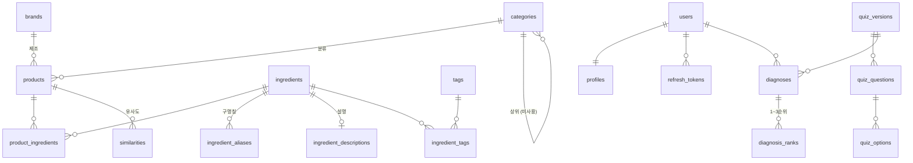

# DB 스키마

> **이 문서가 스키마의 정본입니다.** PRD v1.8 §7.9는 설계 시점의 안이라 테이블·컬럼명이 다릅니다.
>
> 스키마 원본은 `backend/app/models/`의 SQLAlchemy 모델이고, 변경은 Alembic 마이그레이션으로만 합니다.
> 이 문서는 그 결과를 사람이 읽기 좋게 옮긴 것이므로, 모델을 고치면 여기도 함께 고쳐야 합니다.

| | |
|---|---|
| DBMS | PostgreSQL 16.15 |
| 호스팅 | Neon (serverless) · branch `production` · db `neondb` |
| 확장 | `pg_trgm` 1.6 |
| alembic head | `c3d9a1e7b2f4` |
| 테이블 | 34 (Phase 1 18 + 개인 데이터 11 + 성분 설명 1 + 영문 제품명 1 + 얼굴 사진 분석 3) |
| 기준일 | 2026-10-03 |

---

## 적재 현황

| 항목 | 값 |
|---|---:|
| 제품 `products` | 4,013 |
| 성분 `ingredients` | 23,147 |
| 제품–성분 연결 `product_ingredients` | 163,103 |
| 성분 별칭 `ingredient_aliases` | 4,411 |
| 성분 설명 `ingredient_descriptions` | 3,687 |
| 브랜드 `brands` | 512 |
| 표준사전 매칭률 | 97.8% |

| 카테고리 | 제품수 | 비율 | 평균 성분수 |
|---|---:|---:|---:|
| 스킨케어 | 2,097 | 52.2% | 41.2 |
| 마스크팩 | 902 | 22.5% | 45.7 |
| 클렌징 | 868 | 21.6% | 33.3 |
| 선케어 | 146 | 3.6% | 52.0 |

얼굴용 4종만 적재합니다. 진단 5개 축이 전부 얼굴 기준이라 헤어·바디 추천은 근거가 없고, 메이크업은 `N종 택1` 기획세트가 호수별 전성분을 한 셀에 이어 붙여 데이터가 오염돼 있습니다. 제외한 카테고리도 CSV 원본에는 남아 있어 `scripts/load_products.py`의 `ALLOWED_CATEGORIES`만 되돌리면 복구됩니다.

---

## 테이블 18개 — 데이터 유무

**데이터가 있는 10개**는 지금 바로 조회할 수 있고, **나머지 8개는 스키마만** 있습니다. 해당 기능이 아직 없어서지 스키마 결함이 아닙니다.

| 도메인 | 데이터 있음 | 스키마만 |
|---|---|---|
| 제품·성분 | `products` `ingredients` `product_ingredients` `ingredient_aliases` `brands` `categories` `tags` `ingredient_tags` | — |
| 사용자·인증 | — | `users` `profiles` `refresh_tokens` |
| 진단 | — | `quiz_versions` `quiz_questions` `quiz_options` `diagnoses` `diagnosis_ranks` |
| 추천 | `similarities` `skin_type_rules` | — |

---

## 관계도



`skin_type_rules`는 `tags.code`를 JSONB 배열로 참조합니다. FK가 아니라 관계도에 선이 없습니다.

---

## 제품 · 성분

### `products` — 4,013행

제품 마스터. **유일키가 `goods_no`인 이유**: 상품명의 77%에 `[7월 올영픽]` 같은 프로모션 접두사가 붙고 55%에 기획/증정 문구가 섞여, 이름 조합으로는 재수집 때마다 같은 제품이 새 행으로 들어옵니다. `goodsNo`가 올리브영의 실제 제품 식별자입니다.

| | 컬럼 | 타입 | | 비고 |
|---|---|---|---|---|
| PK | `id` | serial | | |
| UQ | `goods_no` | varchar(50) | NOT NULL | 올리브영 제품 식별자 |
| | `name` | text | NOT NULL | **정제 전 원본** (아래 설명) |
| | `display_name` | text | NULL | 화면 표시용 정제명 |
| FK | `brand_id` | int | NULL | → `brands` [SET NULL] |
| FK | `category_id` | int | NULL | → `categories` [SET NULL] |
| | `price` | int | NULL | 원 단위 |
| | `list_price` | int | NULL | 할인 전 정가 |
| | `discount_rate` | smallint | NULL | |
| | `rating` | numeric(2,1) | NULL | |
| | `review_count` | int | NULL | |
| | `image_url` | text | NULL | |
| | `product_url` | text | NULL | |
| | `volume` | text | NULL | 상품정보제공고시 원문 |
| | `volume_ml` | numeric(10,2) | NULL | 총 내용량(부피) · 3,148건 |
| | `volume_uncertain` | bool | NOT NULL | `= false` · 총량을 믿을 수 없는 제품 · 113건 |
| | `unit_count` | int | NULL | 매수·개수 · 247건 |
| | `unit_kind` | text | NULL | sheet(매·장) / piece(개) |
| | `unit_price` | numeric(12,2) | NULL | **생성 컬럼** · 단가 |
| | `unit_label` | text | NULL | **생성 컬럼** · sheet / ml10 / g10 / piece |
| | `volume_g` | numeric(10,2) | NULL | 총 내용량(무게) · 752건 |
| | `country` | text | NULL | 상품정보제공고시 |
| | `manufacturer` | text | NULL | 최대 435자라 길이 제한 없음 |
| | `expiry` | text | NULL | 상품정보제공고시 |
| | `report_no` | text | NULL | 식약처 보고번호 |
| | `ingredient_count_raw` | int | NULL | 원본 성분 개수 (아래 설명) |
| | `status` | text | NOT NULL | `= 'active'` · active/soldout/discontinued |
| | `source` | text | NOT NULL | `= 'oliveyoung'` |
| | `composition` | text | NOT NULL | `= 'single'` · single/bonus/goods/bundle (아래 설명) |
| | `created_at` `updated_at` | timestamptz | NOT NULL | `= now()` |

**`name`과 `display_name`**은 역할이 다릅니다. `name`은 정제 전 원본이라 `기획`·`N종 택1`·`+50ml` 같은 문구가 살아 있고, 그게 `composition` 판정의 입력이라 지우면 분류가 깨집니다. 화면에는 `display_name`(v5 정제명)을 쓰고, NULL이면 `name`으로 떨어집니다. 검색은 양쪽을 모두 봅니다 — 정제 과정에서 지워진 단어로 검색한 사용자가 아무것도 못 찾으면 안 되기 때문입니다.

```
name          에스트라 아토베리어365 세라-히알 속수분 앰플 30ml+30ml 리필 기획
display_name  에스트라 아토베리어365 세라-히알 속수분 앰플 30ml
```

정제명이 원본과 다른 제품은 1,392건이고 **전부 `composition <> 'single'`** 입니다. 기획·증정 문구가 있다는 것 자체가 단일제품이 아니라는 뜻이라, 기본 조회(single만)에서는 두 값이 같습니다.

**`ingredient_count_raw`**는 원본 전성분을 파싱한 성분 개수(중복 포함)로, `product_ingredients` 행수와 다릅니다. 그쪽은 제품 내 중복을 한 번만 세기 때문입니다. **차이가 클수록 `N종 택1` 기획세트일 가능성이 높습니다** — 최대 사례가 원본 1,978개 → 고유 141개입니다.

**`volume_ml` · `volume_g`**는 총 내용량입니다. 원문인 `volume`과 달리 계산용이라 숫자로 담습니다. 부피와 무게는 직접 비교할 수 없어 컬럼을 나눴습니다 — 단가는 `price / volume_ml`처럼 바로 냅니다. 값은 v5의 `내용량_정리`에서 오고, `'+'`로 이어진 구성품별 수량을 단위끼리 합산합니다(`'2ml + 28g'` → ml 2 · g 28, 50건). `'70매'`짜리 시트마스크처럼 ml·g 표기가 없는 제품은 둘 다 NULL이며 대부분 마스크팩입니다.

**단가(`unit_price`)는 총액 비교가 어긋나는 것을 막습니다.** 마스크팩에 `20매` 같은 대용량이 섞여 있어, 총액만 보면 80,000원/20매가 3,000원/1매보다 27배 비싼 것처럼 정렬됩니다. 실제로는 1매당 4,000원 대 3,000원이고, **1매당 단가는 대용량이 오히려 절반**입니다(중앙값 1,500원 대 3,000원). 그래서 "1매 제품만 노출"이 아니라 단가를 답으로 택했습니다 — 그렇게 걸렀으면 마스크팩이 575 → 148건으로 무너지고 사용자에게 가장 비싼 선택지만 남습니다.

기준은 `1매당 > 10ml당 > 10g당 > 1개당` 순으로 고릅니다. **매수가 있으면 매수가 이깁니다** — 사용자가 실제로 소비하는 단위가 "한 장"이라서입니다. `sheet`(매·장)와 `piece`(개)를 나누는 것이 이 우선순위를 카테고리 하드코딩 없이 결정합니다. `325ml (2개)` 토너의 "1개당"은 비교에 쓸모가 없지만 `10매` 마스크팩의 "1매당"은 쓸모가 있습니다.

| 기준 | `unit_label` | 단일제품 | 중앙값 |
|---|---|---:|---:|
| 1매당 | `sheet` | 240 | 1,500원 |
| 10ml당 | `ml10` | 1,852 | 2,000원 |
| 10g당 | `g10` | 379 | 2,083원 |
| 1개당 | `piece` | 7 | 2,225원 |
| 없음 | NULL | 11 | — |

**`10` 단위를 쓰는 이유**: `1ml당`이면 대부분 100~300원대가 되어 카드에서 읽히지 않습니다. 10 단위면 중앙값이 2,000원으로 총액과 자릿수가 비슷해집니다.

**생성 컬럼(`GENERATED ALWAYS AS ... STORED`)으로 둔 이유**: 가격·내용량이 바뀌면 자동으로 따라가 어긋날 수 없고, 정렬에 쓸 인덱스를 걸 수 있습니다. 식은 마이그레이션 `b8c9d0e1f2a3`에 있습니다.

**ml과 g가 둘 다 있으면 단가를 내지 않습니다.** 어느 쪽이 본품인지 알 수 없습니다 — `'15ml + 6g'`는 본품이 6g 크림이고 `'2ml + 116g'`는 본품이 116g 겔마스크라, "큰 쪽"이라는 규칙도 통하지 않습니다. 단일제품 4건이라 영향이 작고, 이 제품들은 `piece`로 떨어집니다.

**`volume_uncertain`이 true인 113건은 숫자가 있어도 믿으면 안 됩니다.** v5 정제 작업자가 총량을 하나로 말할 수 없다고 표시한 제품입니다 — `'각 옵션별 용량이 다름'`이거나, `'409ml (6개) + 210매'`처럼 본품과 동봉품의 단위가 섞여 있습니다. 파서는 그중 103건에서 숫자를 뽑아내므로, 단가(`price / volume_ml`)를 낼 때는 이 제품을 빼야 합니다.

**`composition`**은 제품 구성입니다. `status`(판매 상태)와는 다른 축이라 '품절된 단일제품'이 성립합니다. `single` 외에는 전성분이 제품 하나에 대응한다고 보장할 수 없어 **유사도 계산에서 빼고 조회 API도 기본으로 숨깁니다**. 판정 규칙은 [`backend/app/utils/composition.py`](../backend/app/utils/composition.py)이고, `scripts/load_products.py`가 적재하면서 채웁니다. 묶음분리로 한 제품이 여러 행이 된 경우에는 **가장 오염된 판정이 이깁니다** — 하나라도 묶음이면 그 제품은 묶음입니다.

| 값 | 건수 | 설명 |
|---|---:|---|
| `single` | 2,489 | 순수 단일제품 |
| `bonus` | 1,091 | 본품 증량·화장품 증정 (`+50ml`, `1+1`) |
| `bundle` | 352 | 묶음·N종·세트·키트 |
| `goods` | 81 | 비화장품 굿즈 동봉 (키링·파우치·브러쉬) |

### `ingredients` — 23,147행

성분 마스터. 대한화장품협회 표준화명칭목록 21,910건 + 크롤링에서 새로 발견된 성분입니다.

| | 컬럼 | 타입 | | 비고 |
|---|---|---|---|---|
| PK | `id` | serial | | |
| UQ | `norm_name` | text | NOT NULL | 조회 키. 표기 흔들림 흡수 |
| | `name_ko` | text | NOT NULL | |
| | `name_en` | text | NULL | INCI |
| | `code` | varchar(20) | NULL | 협회 성분코드. NULL이면 사전에 없는 성분 |
| | `ewg_grade` | smallint | NULL | **미큐레이션** |
| | `grade` | text | NULL | **미큐레이션** · key/normal/warn |
| | `is_allergen` | bool | NOT NULL | `= false` |
| | `created_at` `updated_at` | timestamptz | NOT NULL | `= now()` |

`norm_name`이 `살리실릭애씨드(0.5%)`와 `살리실릭애씨드`를 같은 행으로 모읍니다.

### `product_ingredients` — 163,103행

제품 ↔ 성분 N:M.

| | 컬럼 | 타입 | | 비고 |
|---|---|---|---|---|
| PK FK | `product_id` | int | NOT NULL | → `products` [CASCADE] |
| PK FK | `ingredient_id` | int | NOT NULL | → `ingredients` [CASCADE] |
| | `position` | smallint | NOT NULL | 전성분 표기 순서 (1부터) |
| | `raw_name` | text | NULL | 크롤링 원문 보존 |

**`position`이 정보입니다.** 화장품 전성분은 함량 내림차순 표기가 원칙이라, RBO 유사도가 이 순서를 씁니다.

**파싱 잔해는 적재 단계에서 버립니다.** 판매자가 입력한 전성분 문자열에는 구분자가 빠지거나 표 머리글이 섞인 것이 있어, 파서가 성분 하나로 접어 버리는 경우가 있습니다(`'참마뿌리추출물슈도알테로모나스발효추출물'`·`'정제수글리세린베타인…'`). 이런 이름은 어느 제품에나 딱 한 번 등장하는 DF=1 성분이 되어 IDF를 최대로 받으므로, 유사도에서 **해당 제품을 부당하게 밀어냅니다.** `scripts/load_products.py`의 `is_residue()`가 신규 등록 직전에 걸러냅니다 — 협회 사전에도 별칭에도 없는 이름에만 적용하므로 실재 성분을 지울 여지가 구조적으로 없고, 판별 규칙 3종은 사전 22,498종에 오탐 0건을 확인했습니다. 현재 54토큰이 여기서 버려집니다.

**파서가 못 쪼갠 이름은 잔해로 남습니다.** `'클렌징오일aha에틸헥실팔미테이트'`처럼 제품명과 성분이 구분자 없이 붙은 것 20종 남짓이 그렇습니다. 꼬리가 사전 성분이면 잘라내는 규칙을 만들어 봤지만, 진짜 INCI명도 꼬리가 성분인 경우가 흔해(`…다이메티콘크로스폴리머`) 사전 22,498종 중 **2,481건이 오탐**이라 버렸습니다. 전부 DF=1이라 유사도 분모만 키우고 분자에는 기여하지 않습니다.

**아무 제품도 안 쓰는 미등록 성분은 적재할 때 함께 지웁니다.** 파서를 고칠 때마다 예전 파싱이 만든 이름이 남는데, 참조가 끊긴 뒤에도 테이블에 쌓여 '성분 N종' 집계를 부풀립니다(한 번에 411종이 정리된 적이 있습니다). 별칭이 가리키는 행은 오타 교정의 도착지라 남깁니다.

### `ingredient_aliases` — 4,411행

구명칭 → 표준명 매핑. `디메치콘`과 `다이메티콘`을 다른 성분으로 세면 유사도가 실제보다 낮게 나옵니다.

| | 컬럼 | 타입 | | 비고 |
|---|---|---|---|---|
| PK | `id` | serial | | |
| UQ | `alias` | text | NOT NULL | |
| FK | `ingredient_id` | int | NOT NULL | → `ingredients` [CASCADE] |
| | `is_ambiguous` | bool | NOT NULL | `= false` · 52건 |
| | `changed_at` | date | NULL | 명칭 변경 고시일 |

`is_ambiguous`는 한 구명칭이 서로 다른 표준명 둘 이상으로 갈리는 경우입니다(`승마추출물` → 촛대승마추출물 / 라케모사승마뿌리추출물). 기계적으로 결정할 수 없어 자동 변환에서 제외합니다.

### `ingredient_descriptions` — 3,687행

성분별 한 줄 설명과 키워드. 마이그레이션 `952adbaa9665`.

| | 컬럼 | 타입 | | 비고 |
|---|---|---|---|---|
| PK FK | `ingredient_id` | int | NOT NULL | → `ingredients` [CASCADE] |
| | `description` | text | NOT NULL | 한 줄 설명 |
| | `keywords` | text[] | NOT NULL | `= '{}'` · 최대 2개 |
| | `source` | varchar(20) | NOT NULL | `llm`(생성 초안) / `reviewed`(검수 완료) |
| | `created_at` `updated_at` | timestamptz | NOT NULL | `= now()` |

**`ingredients`에 컬럼을 더하지 않고 테이블을 나눈 이유**: 출처가 다릅니다. `ingredients`는 협회 사전이 원본이고, 설명은 `data/seed/ingredient_descriptions.csv`가 원본입니다. 설명을 고칠 때는 CSV를 고치고 `scripts/seed_ingredient_descriptions.py`를 다시 돌립니다. 이 스크립트는 몇 번을 돌려도 결과가 같습니다. 설명은 제품 상세 응답(`GET /api/v1/products/{id}`의 `ingredients[]`)에 실리므로, 적재가 끝나면 스크립트가 `products:cache_version`을 올려 상세 캐시를 비웁니다. 호스트에서 돌릴 때는 `REDIS_HOST=localhost`를 앞에 붙이세요. 기본값 `redis`는 도커 네트워크 안에서만 풀리는 이름이라, 붙이지 않으면 캐시 갱신이 실패하고(스크립트는 무시하고 성공 처리) 옛 설명이 캐시 TTL 동안 나갑니다.

**키워드는 고정 어휘 20개에서만 고릅니다.** 효능 10개(보습·진정·장벽강화·브라이트닝·탄력·항산화·피지조절·각질케어·자외선차단·영양)는 화면 칩용이고, 역할 10개(용제·보존·유화·세정·점증·pH조절·향료·사용감개선·안정화·색소)는 정제수·EDTA처럼 효능이 없는 성분을 분류하는 데 씁니다. 자유 입력을 허용하면 '보습'·'수분공급'이 갈라져 필터가 무너지므로 적재 스크립트가 어휘 밖 값을 거부합니다. '미백'·'주름개선'은 기능성 인증 표현이라 키워드로 쓰지 않습니다.

제품에 쓰이는 성분 4,277종 중 3,687종에 설명이 있고, 연결 기준으로는 99.6%를 덮습니다. 비어 있는 590종은 영문명이 없는 파싱 잔해(제품명 혼입·성분 두 개가 붙은 이름)이고, 대부분 한 제품에만 나옵니다.

### `brands` — 512행

| | 컬럼 | 타입 | |
|---|---|---|---|
| PK | `id` | serial | |
| UQ | `name` | text | NOT NULL |
| | `created_at` `updated_at` | timestamptz | `= now()` |

추천 시 '동일 브랜드 최대 N개' 다양성 보정에 씁니다.

### `categories` — 4행

| | 컬럼 | 타입 | | 비고 |
|---|---|---|---|---|
| PK | `id` | serial | | |
| UQ | `code` | text | NOT NULL | 스킨케어/마스크팩/클렌징/선케어 |
| | `label` | text | NULL | |
| FK | `parent_id` | int | NULL | → `categories` [SET NULL] · **현재 전부 NULL** |
| | `created_at` `updated_at` | timestamptz | NOT NULL | `= now()` |

`parent_id` 자기참조로 2단계를 담을 수 있지만 지금은 1단계만 씁니다. 스킨케어 소분류(토너·세럼·크림)가 붙을 자리입니다.

### `ingredient_functions` — 1,686행 (성분 기능 분류 — **현행 정본**)

성분마다 기능·역할·주의 플래그·확신도를 한 번만 분류해 둔 테이블입니다. 유사도(`hybrid`)·피부 궁합·피부타입 필터·전성분 칩이
모두 이것을 씁니다. 원본은 `data/seed/ingredient_functions/labels.csv`, 적재는 `scripts/seed_ingredient_functions.py`.

| | 컬럼 | 타입 | | 비고 |
|---|---|---|---|---|
| PK FK | `ingredient_id` | int | NOT NULL | → `ingredients` [CASCADE] |
| | `functions` | text[] | NOT NULL | H보습 B장벽 S진정 W미백 A주름·탄력 O항산화 P피지·모공 E각질 U자외선 |
| | `role` | char(1) | NOT NULL | a활성 e에몰리언트 s용매 f계면활성 t점증 p방부 x기타 j오염 |
| | `flags` | text[] | NOT NULL | I자극 소지 F향료 L건조 알코올 |
| | `confidence` | smallint | NOT NULL | 1낮음(근거에서 제외) · 2보통 · 3확실 |
| | `source` | varchar(20) | NOT NULL | ai_expert · reviewed · mfds · cosing |
| | `allergen_listed` | bool | NOT NULL | 식약처 알레르기 유발 착향제 고시 목록의 성분 |
| | `note` · `created_at` · `updated_at` | | | |

### `tags` — 11행 · `ingredient_tags` — 489행 ⚠️ 더 이상 읽지 않음

효능 태그 마스터와 성분 ↔ 태그 조인. **`ingredient_functions` 기반으로 전환했고 코드는 이 테이블을 읽지 않습니다**
(`skin_type_rules`, `ingredients.grade`·`is_allergen` 포함). 안정되면 다음 릴리스에서 삭제합니다.

```
tags              : id(PK) · code(UQ, 예: moisture_balance) · label(예: 유수분 밸런싱)
ingredient_tags   : ingredient_id(PK,FK) · tag_id(PK,FK)
```

원본은 PR #36의 `data/seed/skin_type_ingredients/criteria.csv`입니다 — 피부타입 8종 × 케어 목적 × ILIKE 키워드 × 공인 출처. 태그 코드는 그 `핵심 케어 목적` 컬럼에서 뽑았습니다.

| `code` | `label` | 출처 행 | 성분 |
|---|---|---|---:|
| `moisture_balance` | 유수분 밸런싱 | 수부지 | 69 |
| `sebum_pore_care` | 피지·모공 항염 | 트러블 | 38 |
| `sebum_control` | 피지 흡착·수렴 | 지성 | 28 |
| `brightening` | 멜라닌 억제 | 색소침착 | 22 |
| `soothing_barrier` | 진정·장벽 강화 | 민감성 | 52 |
| `deep_moisture` | 보습막 형성 | 건성 | 66 |
| `anti_wrinkle` | 주름·탄력 | 탄력저하 | 166 |
| `antioxidant` | 항산화 | 건강한 피부 | 20 |

**기피 태그 3종**은 성격이 다릅니다. 추천 태그가 `criteria.csv`의 키워드를 **부분 일치**로 찾는 것과 달리, 이쪽은 **이름이 정확히 일치할 때만** 붙입니다 — `'알코올'`을 부분 일치로 찾으면 세틸알코올·세테아릴알코올 같은 고급지방알코올까지 걸리는데 그건 오히려 보습제입니다. 정의와 출처는 [`exclusion_criteria.csv`](../data/seed/skin_type_ingredients/exclusion_criteria.csv)에 있습니다.

| `code` | `label` | 성분 | 해당 단일제품 | 출처 |
|---|---|---:|---:|---|
| `allergen_fragrance` | 알레르기 유발 착향제 | 23 | 542 | 식약처 고시 착향제 26종 (그중 사전에 있고 제품에 쓰이는 23종) |
| `fragrance` | 향료 | 2 | 777 | `향료`·`조합향료` — 성분을 특정할 수 없는 혼합 착향제 |
| `drying_alcohol` | 건조 유발 알코올 | 3 | 265 | `변성알코올`·`에탄올`·`알코올` |

`allergen_fragrance`에 해당하는 성분은 `ingredients.is_allergen`에도 `true`로 표시합니다. 성분 단위 질의(상세 화면의 알레르기 주의 표시 등)가 태그 조인 없이 쓰도록 하기 위해서입니다.

**태그를 타입 ID(`subuji`·`hwasan`)가 아니라 효능명으로 둔 이유**는 `skin_type_rules.include_tags = ['subuji']`가 되면 태그 층이 동어반복이 되기 때문입니다. 효능명이면 나중에 태그를 쪼개거나 축을 더해도 타입 정의를 건드리지 않습니다.

**태깅 대상은 단일제품에 실제 등장하는 성분 3,643종뿐입니다.** 성분 마스터 23,147종의 80.6%는 어떤 제품에도 쓰이지 않는 협회 사전 어휘라, 태그를 붙여도 조인되지 않고 집계만 부풉니다 — `펩타이드`는 마스터 1,517종 중 제품에 쓰이는 게 137종(9%)뿐이라, 마스터 전체를 태깅하면 `anti_wrinkle`만 1,364종이 됩니다.

**PR #36의 타입별 CSV 8개는 읽지 않습니다.** 성분 25,923건 시절의 스냅샷이라 `id` 기준 일치율이 74%(2,815/3,223)까지 떨어졌습니다 — id가 이미 다른 성분을 가리킵니다. 대신 `criteria.csv`의 키워드로 현재 DB를 다시 조회합니다(`scripts/seed_skin_type_tags.py`). 성분이 바뀌면 재실행으로 따라갑니다.

키워드 7개는 협회 표준명과 철자가 달라 `criteria_overrides.csv`에서 교정합니다 (`히알루론`→`하이알루로`, `카모마일`→`캐모마일`, `레티날`→`레틴알`, `트라네사믹`→`트라넥사믹`, `아주렌`→`아줄렌`, `EGF`→`올리고펩타이드-1`, `아젤라익애씨드`는 어떤 철자로도 없어 제외). `criteria.csv` 자체는 PR #36 원본 그대로 둡니다.

태그 성분을 하나라도 가진 단일제품은 **2,435 / 2,489건(97.8%)**입니다.

---

## 추천

### `similarities` — 146,940행

유사도 배치(Task 3)가 채웁니다. **단일제품(`composition = 'single'`) 2,489건만** 대상이라, 기획세트·굿즈 동봉 제품은 기준으로도 대체품으로도 등장하지 않습니다.

| | 컬럼 | 타입 | | 비고 |
|---|---|---|---|---|
| PK FK | `product_id` | int | NOT NULL | → `products` [CASCADE] · **기준 제품** |
| PK FK | `similar_id` | int | NOT NULL | → `products` [CASCADE] · **대체품** |
| PK | `method` | text | NOT NULL | tfidf / hybrid |
| | `score` | float8 | NOT NULL | 0~1 |
| | `shared_ingredients` | jsonb | NULL | 근거 표시용 |
| | `computed_at` | timestamptz | NOT NULL | `= now()` |

**방향이 있는 관계입니다.** 제품별 상위 20개만 저장하므로 A의 상위권에 B가 있어도 B의 상위권에 A가 있다는 보장이 없습니다. 양방향 조회가 필요하면 배치가 두 행을 모두 넣어야 합니다.

`method`를 PK에 포함해 TF-IDF·hybrid 결과를 나란히 두고 비교할 수 있게 했습니다.

### `product_skin_fit` — 32,104행 (제품 × 피부타입 궁합, 사전 계산)

`services/skin_fit.evaluate`가 성분 기능 라벨로 계산한 결과를 `scripts/compute_skin_fit.py`가 적재합니다(전 제품 × 8타입, 멱등).
**목록 정렬(`sort=skinFit`)·피부타입 필터(`excluded`)·홈 추천 점수·예산 가이드·궁합 배지/대체품 `skinMatch`가 모두 이 테이블을 읽습니다.**
라벨이나 규칙(`PREFER`/`AVOID`/하드 제외)을 바꾸면 배치를 다시 돌려야 합니다.

| | 컬럼 | 타입 | | 비고 |
|---|---|---|---|---|
| PK FK | `product_id` | int | NOT NULL | → `products` [CASCADE] |
| PK | `skin_type` | text | NOT NULL | 8타입 코드 |
| | `score` | smallint | NULL | 0~100. 근거 부족이면 NULL |
| | `verdict` | text | NOT NULL | good / ok / caution / unknown |
| | `matched` | smallint | NOT NULL | 그 타입의 선호 기능을 가진 성분 수 |
| | `excluded` | bool | NOT NULL | 이 타입의 필터가 목록에서 빼는 제품(고시 목록·일반 향료 / 건조 알코올) |
| | `has_fragrance` · `has_drying_alcohol` | bool | NOT NULL | 타입과 무관한 사실(예산 가이드의 무향·무알코올) |
| | `computed_at` | timestamptz | NOT NULL | |

### `skin_type_rules` — 8행 ⚠️ 더 이상 읽지 않음

(예전) 피부타입 8종별 추천·회피 태그. 규칙의 정본은 이제 `services/skin_fit.py`의 `PREFER`/`AVOID`입니다. 아래는 옛 설명입니다.

```
id(PK) · skin_type(UQ) · include_tags(jsonb) · exclude_tags(jsonb)
is_active(bool = true) · updated_at
```

`skin_type`은 `docs/dev_guidelines.md` §2.4의 캐릭터 ID입니다.

| `skin_type` | 표시명 | `include_tags` |
|---|---|---|
| `subuji` | 겉바속촉 수부지 | `["moisture_balance"]` |
| `hwasan` | 울긋불긋 화산 | `["sebum_pore_care"]` |
| `mulgae` | 반질반질 물개 | `["sebum_control"]` |
| `memilmuk` | 얼룩덜룩 메밀묵 | `["brightening"]` |
| `yuriguseul` | 조심조심 유리구슬 | `["soothing_barrier"]` |
| `samak` | 바스락 사막 | `["deep_moisture"]` |
| `injeolmi` | 말랑말랑 인절미 | `["anti_wrinkle"]` |
| `ondalsam` | 수분팡팡 옹달샘 | `["antioxidant"]` |

**타입당 태그 1개로 시작합니다.** `수부지 = moisture_balance + sebum_control`처럼 그럴듯한 조합을 만들 수는 있지만 근거가 `criteria.csv`에 없습니다. 추론으로 넣으면 나중에 왜 그런지 설명할 수 없으므로, 1:1로 두고 Task 14에서 실물 추천 결과를 보며 넓힙니다.

**`exclude_tags`는 4개 타입에만 붙습니다.** 배정 근거는 [`skin_type_exclusions.csv`](../data/seed/skin_type_ingredients/skin_type_exclusions.csv)의 `근거` 컬럼에 한 줄씩 적혀 있습니다. 나머지 4타입은 빈 배열입니다 — 지성(물개)처럼 휘발성 알코올이 오히려 선호되는 경우가 있어 일괄 적용하지 않았습니다.

| `skin_type` | `exclude_tags` |
|---|---|
| `yuriguseul` (민감성) | `allergen_fragrance` · `fragrance` · `drying_alcohol` |
| `hwasan` (트러블) | `allergen_fragrance` · `fragrance` |
| `samak` (건성) | `drying_alcohol` |
| `subuji` (수부지) | `drying_alcohol` |

민감성 기준으로 세 태그를 하나도 갖지 않는 단일제품이 **1,390 / 2,489건(55.8%)**이라 필터로 쓸 만한 규모입니다.

**`injeolmi`의 캐릭터 정의를 '탄력 저하, 주름'으로 맞췄습니다.** PR #36이 임상명 '탄력저하'를 여기 넣었는데 기존 캐릭터 정의는 '건성·탄력 양호'라 뜻이 반대였습니다. 태그를 따라가는 쪽으로 정리했고, `docs/dev_guidelines.md` §2.4와 프론트 문구(`frontend/src/data/skinTypes.ts`)도 함께 고쳤습니다.

**조회가 이 규칙을 읽습니다.** [`app/services/skin_type.py`](../backend/app/services/skin_type.py)가 규칙을 SQL 조건으로 번역하고, 세 곳이 씁니다.

| 엔드포인트 | 하는 일 |
|---|---|
| `GET /products?skinType=` | `exclude_tags` 성분이 든 제품을 뺀다. `sort=skinFit`이면 `include_tags` 성분 수로 정렬 |
| `GET /products/search?skinType=` | 같은 필터. 목록만 걸러지면 검색으로 우회된다 |
| `GET /products/{id}/similar?skinType=` | 기피 성분이 든 대체품을 뺀다 |

챗봇(`app/services/rag.py`)도 진단된 타입을 받으면 같은 필터를 겁니다 — 검색 결과가 없을 때의 폴백에도 겁니다. "추천할 게 없다"며 내놓는 제품이 정작 사용자가 피해야 할 것이면 안 되기 때문입니다.

실측 효과 — 단일제품 2,489건 중 민감성(`yuriguseul`) 기준으로 **1,390건(55.8%)**이 남습니다. 향수·애프터쉐이브만 대체품이던 제품은 민감성 기준에서 대체품이 0건이 됩니다.

**모르는 타입에는 404를 내지 않습니다.** 진단 결과가 바뀌거나 규칙을 잠시 꺼 둔 사이에 화면이 통째로 비는 편이 더 나쁘므로, 필터 없이 전체를 냅니다.

**제외는 `EXISTS` 서브쿼리로 겁니다.** `JOIN` + `DISTINCT`로 짜면 기피 성분이 여러 개 걸리는 제품이 중복 행으로 나와 페이지네이션의 `total`이 부풀어 오릅니다.

---

## 진단

`diagnoses.guest_token`과 `user_id` NULL 허용은 **Soft-gate 시절의 흔적**입니다. 비회원도 진단하고 가입할 때 계정에 붙이는 구조였는데, 승계 장치가 생기기 전에 저장된 게스트 진단이 주인을 찾지 못한 채 브라우저에 남아 둘러보기만 한 사람에게 표시되는 일이 있어 걷어냈습니다.

**지금 진단은 로그인 이후에만 가능합니다**(`POST /profile/skin-quiz`가 인증을 요구하고, `/claim`은 제거했습니다). 이 컬럼은 더 채워지지 않으며, 과거 행을 지우지 않으려고 컬럼만 남겨 두었습니다.

### `diagnoses` — 0행

| | 컬럼 | 타입 | | 비고 |
|---|---|---|---|---|
| PK | `id` | bigserial | | |
| FK | `user_id` | uuid | NULL | → `users` [CASCADE] |
| | `guest_token` | text | NULL | Soft-gate 시절의 흔적 — 더 채워지지 않음 |
| FK | `version_id` | int | NOT NULL | → `quiz_versions` [RESTRICT] |
| | `answers` | jsonb | NOT NULL | |
| | `scores` | jsonb | NOT NULL | 5개 축. 얼굴 사진 분석을 섞었으면 **섞인 뒤의 값** |
| FK | `analysis_id` | uuid | NULL | → `skin_analyses` [SET NULL]. 사진 분석을 섞은 진단이면 그 분석, NULL이면 QnA 100% |
| | `created_at` | timestamptz | NOT NULL | `= now()` |

문항이 바뀌어도 과거 결과를 해석할 수 있도록 `version_id`를 남깁니다. FK가 RESTRICT라 진단 기록이 있는 버전은 삭제되지 않습니다.

### 나머지 4개

```
diagnosis_ranks : diagnosis_id(PK,FK) · rank(PK, smallint) · skin_type · score
                  → 이슈 #8의 '2·3순위 결과 표시' 요구사항이 여기 대응
quiz_versions   : id(PK) · label · is_active(= false) · created_at
                  → is_active 하나만 켜서 현행 문항을 정한다
quiz_questions  : id(PK) · version_id(FK) · code · axis · body · order_no
                  → axis가 5개 진단 축 중 어디에 기여하는지 정한다
quiz_options    : id(PK) · question_id(FK) · label · weights(jsonb) · order_no
                  → weights에 축별 가중치를 담아 점수 계산을 데이터로 뺐다
```

---

## 얼굴 사진 AI 분석

QnA 진단에 **얼굴 사진 분석**(Perfect Corp YouCam Skin Analysis)을 선택으로 더합니다. 세 테이블 모두 **원본 사진을 담지 않습니다** — 사진은 요청 중 메모리에만 있고(`docs/dev_guidelines.md` 11.2), 업체가 돌려주는 분석 이미지 URL(2시간 만료)도 저장하지 않습니다. 대신 서버가 분석 직후 그 마스크를 받아 **DB가 아닌 디스크 볼륨**(`SKIN_IMAGE_DIR/<user_id>/<analysis_id>/<항목>.png` — 업체의 투명 마스크 PNG 그대로, 얼굴 사진 없음)에 보관합니다. `skin_analyses.metrics.images`는 키 목록일 뿐이고 실제로 있는 파일은 디렉터리를 봅니다(마이그레이션 없음). 동의 철회·계정 삭제 때 파일을 지웁니다. 마이그레이션 `c3d9a1e7b2f4`.

```
user_consents : id(PK, uuid) · user_id(FK → users [CASCADE]) · consent_type(= 'face_photo')
                version · agreed_at · withdrawn_at(NULL 허용)
                UNIQUE(user_id, consent_type)
                → (사용자, 종류)당 1행. 재동의·철회는 같은 행을 갱신한다.
                  version은 동의받을 당시 문구의 버전(config FACE_CONSENT_VERSION) —
                  문구가 바뀌면 옛 동의는 현재 문구에 대한 동의로 보지 않는다

subscriptions : id(PK, uuid) · user_id(FK → users [CASCADE]) · plan(= 'ai_skin_care')
                status(= 'active' | 'cancelled') · current_period_start · current_period_end
                created_at · cancelled_at(NULL 허용)          INDEX(user_id, current_period_end)
                → **결제는 붙어 있지 않다**(데모 활성화, 기간 30일). 해지해도
                  current_period_end까지는 구독자로 본다

skin_analyses : id(PK, uuid) · user_id(FK → users [CASCADE]) · created_at
                quota_kind(free | subscription) · concern_set(basic | extended)
                provider_mode(sd | hd | mock) · metrics(jsonb)  INDEX(user_id, created_at)
                → 성공한 분석 1회 = 1행. 월 이용 횟수도 이 행을 센다.
                  metrics = {axes, concerns{key:{raw,ui}}, skin_types{whole,t_zone,u_zone}}
```

**이용 한도**(`services/skin_quota.py`): 얼굴 사진 수집에 동의한 사용자만 쓸 수 있고, 무료 월 1회·구독자 월 4회입니다(Asia/Seoul 달 경계). 얼굴이 인식되지 않는 등 **실패는 행을 만들지 않아 한도를 쓰지 않습니다.** 분석 항목은 무료 8개(호출당 12유닛), 구독자 12개(14유닛)입니다.

**진단 혼합**: `POST /profile/skin-quiz`에 `analysisId`를 실으면 서버가 저장된 분석의 5축 점수를 QnA에 `PHOTO_BLEND_WEIGHT`(기본 0.4) 비중으로 섞습니다. 점수는 클라이언트가 보내지 않으며, 1시간 안의 본인 분석만 받습니다. `analysisId`가 없으면 QnA 100%입니다.

---

## 사용자 · 인증

JWT 기반(Task 12, 미착수). `users.id`는 UUID이고 `gen_random_uuid()`로 DB가 직접 발급합니다.

```
users          : id(PK, uuid = gen_random_uuid()) · email(UQ) · password_hash(NULL 허용)
                 nickname · provider(= 'local') · is_active(= true)
                 created_at · last_login_at
                 → 소셜 로그인은 password_hash가 비어 있으므로 NULL 허용

profiles       : user_id(PK, FK → users [CASCADE]) · skin_type · scores(jsonb)
                 budget_min · budget_max · domains(jsonb) · created_at · updated_at
                 → user_id가 PK이자 FK인 1:1 확장

refresh_tokens : id(PK, uuid = gen_random_uuid()) · user_id(FK) · token_hash
                 expires_at · revoked_at · created_at
                 → 원문이 아니라 해시를 저장하고 revoked_at으로 무효화
```

---

## 인덱스

유일키가 자동 생성하는 인덱스는 제외한 목록입니다.

| 인덱스 | 테이블 | 정의 | 용도 |
|---|---|---|---|
| `idx_products_name_trgm` | products | `gin (name gin_trgm_ops)` | 제품명 부분일치 검색 |
| `idx_products_brand` | products | `btree (brand_id)` | 브랜드 필터 |
| `idx_products_category` | products | `btree (category_id)` | 카테고리 필터 |
| `idx_products_price` | products | `btree (price)` | 가격 정렬·범위 |
| `idx_products_unit_price` | products | `btree (unit_price)` | 단가 정렬 |
| `idx_products_status` | products | `btree (status)` | 품절 제외 |
| `idx_product_ingredients_ingredient` | product_ingredients | `btree (ingredient_id)` | 성분 → 제품 역방향 |
| `idx_ingredients_code` | ingredients | `btree (code)` | 사전 갱신 대조 |
| `idx_similarities_lookup` | similarities | `btree (product_id, method, score DESC)` | 상위 N개 추천 조회 |
| `idx_diagnoses_user` | diagnoses | `btree (user_id, created_at)` | 최근 진단 조회 |
| `idx_diagnoses_guest` | diagnoses | `btree (guest_token)` | Soft-gate 시절의 흔적 |
| `idx_quiz_questions_version` | quiz_questions | `btree (version_id, order_no)` | 문항 순서 조회 |
| `idx_refresh_tokens_hash` | refresh_tokens | `btree (token_hash)` | 토큰 검증 |
| `idx_refresh_tokens_user` | refresh_tokens | `btree (user_id)` | 전체 로그아웃 |

**명명 규칙** — 인덱스는 `idx_<테이블>_<용도>`, 제약 44개는 모두 `<테이블>_<컬럼>_<종류>`를 따릅니다.

---

## 적재 파이프라인

`.env`에 `DATABASE_DSN`만 넣으면 아래 순서로 같은 상태에 도달합니다. **두 스크립트 모두 멱등해서 몇 번을 돌려도 행수가 변하지 않습니다.** 자세한 절차는 [backend/README.md](../backend/README.md) 참고.

| | 명령 | 하는 일 |
|---|---|---|
| 1 | `cd backend && alembic upgrade head` | 테이블 18개 + `pg_trgm` 확장 생성 |
| 2 | `python scripts/seed_ingredients.py` | 협회 표준화명칭목록·명칭변경목록 + 오타 교정 CSV → `ingredients` + `ingredient_aliases` |
| 3 | `python scripts/load_products.py` | v5 정제본 5,157행 → 카테고리 교정·제외 목록 → 필터 → dedup → 전성분 파싱 → 벌크 삽입 |
| 4 | `python scripts/seed_skin_type_tags.py` | `criteria.csv` 키워드로 `tags` · `ingredient_tags` · `skin_type_rules` 채우기 |
| 5 | `python scripts/compute_similarities.py` | 단일제품 유사도 계산 → `similarities` |

**순서 의존이 없습니다.** 예전에는 3번 뒤에 보정 스크립트 둘(`apply_category_fixes.py` · `backfill_from_v5.py`)을 반드시 다시 돌려야 했습니다. 구 CSV를 적재 기준으로 쓰는 동안에는 거기에 교정 전 카테고리가 들어 있고 `처리메모`·`증정기획_정리`·`내용량_정리` 컬럼이 아예 없어서, 로더가 보정 결과를 매번 덮어썼기 때문입니다. **적재 기준을 v5로 옮기면서 두 스크립트를 지웠습니다** — 로더가 카테고리 교정 로그까지 직접 읽어 적재 전에 반영합니다.

4·5번은 여전히 3번 뒤에 돌려야 합니다. 성분 연결(`product_ingredients`)이 다시 만들어지면 태깅 대상과 유사도 입력이 함께 바뀌기 때문입니다. 다만 이건 *되돌려지는* 것이 아니라 *다시 계산해야 하는* 것이라, 빠뜨리면 값이 낡을 뿐 틀리지는 않습니다.

**카테고리 교정은 믿지 않습니다.** v5를 적재 기준으로 쓰는 것과 v5의 카테고리를 신뢰하는 것은 별개입니다 — 같은 파일 안에서도 컬럼마다 작업 성격이 다릅니다.

| | 성격 | 신뢰 |
|---|---|---|
| 전성분 · 상품명 · 내용량 | 규칙이 분명한 정제 (문구 제거, 단위 통일) | 그대로 씁니다 |
| 카테고리 | 사람의 판단이 들어간 재분류 | **제외 목록으로 뺍니다** |

카테고리가 바뀐 제품은 154건인데 교정 로그에 사유가 적힌 것은 38건뿐이라, 나머지가 왜 바뀌었는지 검증할 방법이 없습니다. 잘못된 카테고리는 "선케어의 대체품이 클렌징"이 되는 결과로 이어지므로 통째로 제외합니다.

목록은 [`data/seed/category_distrusted.csv`](../data/seed/category_distrusted.csv)에 있고 `load_products.py`가 읽습니다. 매 적재마다 구 CSV와 다시 대조하지 않는 이유는 **어떤 제품이 왜 빠지는지가 저장소에 남아야** 하기 때문입니다 — 나중에 "패드류 34건(`마스크팩 → 스킨케어`)은 교정이 맞다"고 판단하면 그 행의 `판정`만 바꾸면 됩니다. `ingredient_typo_fixes.csv`와 같은 방식입니다.

```
goods_no,이전,이후,사유,판정,상품명
A000000110505,이너뷰티,마스크팩,이너뷰티 오분류: 마스크/패드/패치,제외,대웅제약 이지덤 스팟패치…
```

`scripts/report_parse_residue.py`는 파이프라인이 아니라 읽기 전용 보고서입니다. 파싱 잔해가 어느 제품에 몰려 있는지 세어, 제품 단위 제거가 필요한지 판단할 근거를 냅니다.

Neon에는 컨테이너 초기화 훅이 없어 `CREATE EXTENSION`을 첫 마이그레이션이 직접 책임집니다.

### 전성분 파싱

`backend/app/utils/ingredients.py`. 이 단계가 데이터 품질을 좌우합니다.

- **구분자 자동 판별** — 쉼표가 표준이지만 공백이나 `@`를 쓰는 제품이 있습니다. 쉼표로 하나밖에 안 나오면 다른 구분자를 시도하고, 공백일 때는 사전 최장일치로 묶습니다
- **쉼표 보호** — 괄호 안 쉼표와 숫자 사이 쉼표는 구분자로 보지 않습니다. 단순 `split(",")`이면 `1,2-헥산다이올`이 쪼개져 `"1"`이 최다 성분(5,599회)이 됩니다
- **`/`는 구분자가 아닙니다** — `약모밀꽃/잎/줄기수`처럼 성분명의 일부입니다

성분 해석은 4단계입니다. **어떤 경우에도 성분을 버리지 않습니다.**

| 경로 | 건수 | 비율 |
|---|---:|---:|
| 정규화 직결 | 195,788 | 98.0% |
| 별칭 경유 | 1,667 | 0.8% |
| 괄호 제거 후 매칭 | 2,361 | 1.2% |
| 미매칭 → `code=NULL`로 신규 등록 | 0 | 0.0% |

---

## 알아둘 것

**유사도 계산에서 빼는 제품이 1,633건 있습니다.**
`N종 택1` 기획세트는 호수별 전성분을 한 셀에 이어 붙입니다. 이런 제품은 '모든 성분을 가진 제품'이 되어 무엇과도 비슷해집니다. 데이터는 버리지 않고 계산 단계에서만 제외합니다 — `composition <> 'single'` 1,595건에 성분 5개 미만 30건, 비율 규칙(`ingredient_count_raw > 고유수 × 2`)에 걸리는 잔여 8건을 더한 수입니다. 자세한 근거는 [docs/similarity.md](similarity.md).

**복수 카테고리 등재 제품 28건은 제품명으로 소속을 정합니다.**
클렌징오일처럼 올리브영이 양쪽에 노출하는 제품이 있습니다. 후보가 2개 이상일 때만 제품명 키워드로 판정하고, 나머지 4,122건은 크롤링 카테고리를 그대로 씁니다. 전수 비교 결과 둘은 96.4% 일치합니다.

**스킨케어 2,099건에 소분류가 없습니다.**
토너·세럼·크림이 한 덩어리라 토너를 찾는데 크림이 추천될 수 있습니다. `categories.parent_id`에 2단계를 담을 수 있고, `load_products.py`의 키워드 로직으로 90%가 자동 분류됩니다.

예산 구매 가이드(Task 15, `POST /api/v1/recommendations/budget`)는 소분류 대신 **제품명 키워드와 단계별 최소 용량**으로 루틴 단계를 나눕니다(`backend/app/services/routine_steps.py`). 판매 중 단일제품 기준 토너 191 · 에센스 372 · 크림 240 · 선크림 30이고, 두 단계에 동시에 걸리는 제품은 없습니다. 최소 용량(토너 80 · 에센스 10 · 크림 30 · 선크림 25, ml/g)은 샘플·미니·스팟 제품을 빼기 위한 것이며 `volume_ml`/`volume_g`를 봅니다. 소분류를 적재하면 이 파일만 카테고리 코드로 바꾸면 됩니다. 예산이 모자라면 뒤쪽 단계(선크림 → 크림 → 에센스)부터 빼고 살 수 있는 만큼 보여 줍니다. 가이드는 조회만 하고 **이력을 저장하지 않습니다**(명세의 `budget_guide_history`는 만들지 않기로 했습니다).

**`ingredients.grade`는 태그에서 도출해 채웠습니다 (4,277종).**
`scripts/seed_skin_type_tags.py`가 `ingredient_tags`를 근거로 판정합니다 — 기피 태그(식약처 표시 의무 착향제·향료·건조 유발 알코올)가 붙으면 `warn`(28종), 추천 태그가 붙으면 `key`(392종), 제품에 쓰이지만 어느 쪽도 아니면 `normal`(3,857종), 어떤 제품에도 안 쓰이면 NULL입니다.

**`ewg_grade`는 여전히 비어 있습니다.** 크롤링으로 얻을 수 없고, 출처를 검증하지 않은 숫자를 채우면 화면이 근거 없는 안전 등급을 주장하게 됩니다. API도 이 값을 내보내지 않습니다.

**Phase 2 개인 데이터 테이블 9개를 추가했습니다** (`d07012ddaaa9`).

`closet_items` · `cart_items` · `likes` · `recently_viewed` · `orders` · `order_items` · `reviews` · `point_transactions` · `scan_results`.

전부 `user_id` FK(ON DELETE CASCADE)이고, 제품을 가리키는 컬럼은 `products.id` FK입니다. **없는 제품이 들어갈 수 없다**는 것이 이 테이블들을 만든 이유입니다 — 이전까지 이 데이터는 프론트 localStorage에 있었고, 목업 시절의 가짜 제품 id(102·960001 등)가 그대로 저장돼 화면이 엉뚱한 제품 상세를 열었습니다.

예외는 `order_items`로, 제품명·가격을 행에 복사해 둡니다. 주문은 "그때 그 가격에 샀다"는 기록이라 제품 가격이 바뀌어도 과거 금액이 따라 움직이면 안 됩니다. `product_id`는 SET NULL이라 제품이 카탈로그에서 내려가도 기록이 남습니다.

**`closet_items.status`는 `owned` / `removed`입니다.** 화장대에서 빼면 행을 지우지 않고 `removed`로 바꿔 '삭제된 제품'에 남깁니다. 다시 담으면(`POST /me/closet`) 같은 행이 `owned`로 돌아오고, 영구 삭제(`DELETE /me/closet/{id}?permanent=true`)만 행을 지웁니다. 대체품·추천·마이페이지 통계는 `removed`를 뺀 제품만 봅니다. **주문하면 산 제품이 화장대에 자동으로 담깁니다**(`added_via = order`, 삭제된 제품이었으면 보유 중으로 복원). 그 주문을 취소·반품하면 주문으로 담긴 제품만 `removed`로 옮기고, 원래 화장대에 있던 제품과 다른 진행 중 주문에도 있는 제품은 그대로 둡니다. 예전 값 `scanned`·`analyzing`은 `owned`와 같게 다룹니다 — 스캔한 제품은 이제 화장대가 아니라 `scan_results`에 먼저 남고, 사용자가 고를 때만 화장대에 `owned`로 담깁니다. 스키마는 그대로이고(text 컬럼) 마이그레이션 없이 값만 늘었습니다.

**주문 취소·반품, 받은 선물, 후기 사진을 추가했습니다** (`a9c1e2f3d4b5`).

| 대상 | 내용 |
|---|---|
| `orders.closed_at` · `close_reason` | 취소·반품 시각과 사유. `status`는 `placed` / `cancelled` / `returned`. 배송 단계(결제완료~배송완료)는 **저장하지 않고** `placed_at`에서 계산합니다(`services/order_stage.py`) — 택배 연동이 없기 때문입니다 |
| `point_transactions.reason` | `order_cancel` / `order_return`이 더해졌습니다. 취소·반품 시 그 주문의 적립을 음수로 회수합니다 |
| `gifts.recipient_user_id` | 받는 사람 계정(닉네임으로 찾음, FK SET NULL). '받은 선물'이 여기서 나옵니다. 이전 행은 NULL — 이름만 적었던 선물입니다 |
| `review_photos` | 후기 사진. 파일 서버가 없어 **바이트를 DB에 둡니다**(장당 2MB, 후기당 3장, `reviews` CASCADE). `GET /api/v1/reviews/photos/{id}`로 공개 |

PR #64로 들어왔다가 revert됐고(PR #67), dev 위에 다시 얹으며 `Revises`를 `a0fd1f8a5d3a`로 옮겼습니다.

**`product_names_en`을 추가했습니다** (`a0fd1f8a5d3a`).

올리브영 글로벌에 올라간 같은 상품의 **영문명 3,175건 / 제품 3,039개**입니다. 원본은 `data/raw/oliveyoung_kr_en_paired.csv`(PR #60)이고 `scripts/seed_product_names_en.py`가 적재합니다. 한글 쪽 상품URL의 `goodsNo`로 `products.product_url`을 역조회해 붙입니다 — CSV의 쌍 3,666건 중 **3,304건(90.1%)**이 붙고, 나머지는 메이크업·건강식품처럼 우리 `products`(스킨케어 4종)에 없는 상품입니다.

`products`에 컬럼을 더하지 않은 이유는 **한 제품이 여러 영문 리스팅에 매칭되기 때문**입니다(`goodsNo` 중복 194건). OCR 대조에는 별칭이 많을수록 유리합니다 — 포장 표기가 그중 하나와 맞으면 찾아집니다. `match_method`·`confidence`·`score`를 함께 남겨 '확인필요' 187건을 질의에서 빼거나 가중할 수 있습니다.

`name_en`에 GIN trgm 인덱스가 있습니다. 다만 3,175행에서는 플래너가 순차 스캔을 택합니다 — 데이터가 커질 때를 위한 것입니다.

**무엇이 달라졌나** — `GET /api/v1/products/match`가 OCR 텍스트를 한글명·영문명에 한꺼번에 대조합니다. 예전에는 영문을 한글 발음으로 근사 전사해 대조했는데, `scripts/eval_product_match.py`로 재 보면 차이가 큽니다(표본 200건).

| | top-1 | top-3 | 후보 0건 |
|---|---:|---:|---:|
| 영문명 직접 대조 | **82.5%** | **98.0%** | 0.0% |
| 한글 발음 전사 후 대조 | 4.5% | 8.5% | 83.5% |

표본을 영문명에서 합성했으므로 앞 행에 유리한 측정입니다. 뒤 행은 "영문 포장을 한글명으로 찾을 때"의 하한으로 읽어야 합니다.

**`gifts`를 추가했습니다** (`929b93541c4a`).

선물하기 기록입니다. `orders`와 같은 성격이고 — 실제 결제도 전달도 없지만 '보낸 선물' 목록이 이 기록에서 파생됩니다 — 제품명·가격을 박제하는 것도 같은 이유입니다. `status`는 전달 수단이 붙기 전까지 항상 `pending`입니다.

**`profiles.notifications_seen_at`을 추가했습니다** (`3f3233afae88`). 알림함을 마지막으로 연 시각입니다. **알림 자체는 저장하지 않습니다** — 주문·포인트·후기·선물·진단 기록에서 뽑아 만듭니다(경험치와 같은 방식). 저장할 것은 "어디까지 읽었는지" 하나뿐입니다.

**`profiles.decoration_id`도 추가했습니다** (`2425accbef26`). 캐릭터 꾸미기 장식이고, 에셋은 `frontend/public/mascot/decoration_*.png`이라 id가 곧 파일 번호입니다. 예전에는 localStorage에만 있어 기기를 바꾸면 사라졌고, 꾸미기 화면의 '저장하기'는 아무 데도 저장하지 않았습니다.

**받는 사람 연락처 컬럼은 일부러 두지 않았습니다.** 전달 경로가 없어 아무 데도 쓰이지 않는데, 쓰이지도 않는 제3자의 개인정보를 공용 DB에 쌓게 됩니다. 실제 발송(문자·카카오)을 붙일 때 그 수단에 맞는 컬럼을 추가합니다. `backend/tests/test_personal.py`의 `test_gift_never_stores_contact_details`가 이 약속을 지킵니다.

---

## 스키마를 바꿀 때

1. `backend/app/models/`의 모델을 고친다
2. `cd backend && alembic revision --autogenerate -m "설명"`
3. **생성된 마이그레이션을 반드시 눈으로 확인한다**
4. `alembic upgrade head` → `alembic check`로 드리프트 없음 확인
5. 이 문서를 함께 갱신한다

> ⚠️ **autogenerate는 rename을 감지하지 못합니다.** 테이블·컬럼 이름을 바꾸면 DROP + CREATE를 만들어 데이터가 사라집니다. rename은 `op.rename_table` / `op.alter_column(new_column_name=)`로 직접 작성하고, `downgrade` → `upgrade` 왕복과 행수 대조로 검증하세요.
