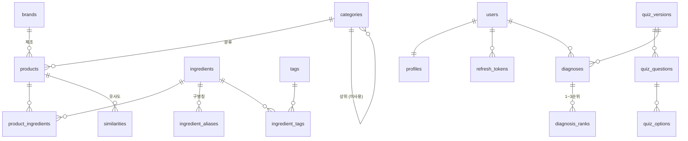

# DB 스키마

> **이 문서가 스키마의 정본입니다.** PRD v1.8 §7.9는 설계 시점의 안이라 테이블·컬럼명이 다릅니다.
>
> 스키마 원본은 `backend/app/models/`의 SQLAlchemy 모델이고, 변경은 Alembic 마이그레이션으로만 합니다.
> 이 문서는 그 결과를 사람이 읽기 좋게 옮긴 것이므로, 모델을 고치면 여기도 함께 고쳐야 합니다.

| | |
|---|---|
| DBMS | PostgreSQL 16.14 |
| 호스팅 | Neon (serverless) · branch `production` · db `neondb` |
| 확장 | `pg_trgm` 1.6 |
| alembic head | `c3d4e5f6a7b8` |
| 테이블 | 18 (Phase 1 전량) |
| 기준일 | 2026-08-17 |

---

## 적재 현황

| 항목 | 값 |
|---|---:|
| 제품 `products` | 4,150 |
| 성분 `ingredients` | 25,923 |
| 제품–성분 연결 `product_ingredients` | 171,334 |
| 성분 별칭 `ingredient_aliases` | 3,967 |
| 브랜드 `brands` | 511 |
| 표준사전 매칭률 | 97.8% |

| 카테고리 | 제품수 | 비율 | 평균 성분수 |
|---|---:|---:|---:|
| 스킨케어 | 2,147 | 51.7% | 41.6 |
| 마스크팩 | 948 | 22.8% | 45.6 |
| 클렌징 | 888 | 21.4% | 33.7 |
| 선케어 | 167 | 4.0% | 52.9 |

얼굴용 4종만 적재합니다. 진단 5개 축이 전부 얼굴 기준이라 헤어·바디 추천은 근거가 없고, 메이크업은 `N종 택1` 기획세트가 호수별 전성분을 한 셀에 이어 붙여 데이터가 오염돼 있습니다. 제외한 카테고리도 CSV 원본에는 남아 있어 `scripts/load_products.py`의 `ALLOWED_CATEGORIES`만 되돌리면 복구됩니다.

---

## 테이블 18개 — 데이터 유무

**데이터가 있는 6개**는 지금 바로 조회할 수 있고, **나머지 12개는 스키마만** 있습니다. 해당 기능이 아직 없어서지 스키마 결함이 아닙니다.

| 도메인 | 데이터 있음 | 스키마만 |
|---|---|---|
| 제품·성분 | `products` `ingredients` `product_ingredients` `ingredient_aliases` `brands` `categories` | `tags` `ingredient_tags` |
| 사용자·인증 | — | `users` `profiles` `refresh_tokens` |
| 진단 | — | `quiz_versions` `quiz_questions` `quiz_options` `diagnoses` `diagnosis_ranks` |
| 추천 | — | `similarities` `skin_type_rules` |

---

## 관계도



`skin_type_rules`는 `tags.code`를 JSONB 배열로 참조합니다. FK가 아니라 관계도에 선이 없습니다.

---

## 제품 · 성분

### `products` — 4,150행

제품 마스터. **유일키가 `goods_no`인 이유**: 상품명의 77%에 `[7월 올영픽]` 같은 프로모션 접두사가 붙고 55%에 기획/증정 문구가 섞여, 이름 조합으로는 재수집 때마다 같은 제품이 새 행으로 들어옵니다. `goodsNo`가 올리브영의 실제 제품 식별자입니다.

| | 컬럼 | 타입 | | 비고 |
|---|---|---|---|---|
| PK | `id` | serial | | |
| UQ | `goods_no` | varchar(50) | NOT NULL | 올리브영 제품 식별자 |
| | `name` | text | NOT NULL | |
| FK | `brand_id` | int | NULL | → `brands` [SET NULL] |
| FK | `category_id` | int | NULL | → `categories` [SET NULL] |
| | `price` | int | NULL | 원 단위 |
| | `list_price` | int | NULL | 할인 전 정가 |
| | `discount_rate` | smallint | NULL | |
| | `rating` | numeric(2,1) | NULL | |
| | `review_count` | int | NULL | |
| | `image_url` | text | NULL | |
| | `product_url` | text | NULL | |
| | `volume` | text | NULL | 상품정보제공고시 |
| | `country` | text | NULL | 상품정보제공고시 |
| | `manufacturer` | text | NULL | 최대 435자라 길이 제한 없음 |
| | `expiry` | text | NULL | 상품정보제공고시 |
| | `report_no` | text | NULL | 식약처 보고번호 |
| | `ingredient_count_raw` | int | NULL | 원본 성분 개수 (아래 설명) |
| | `status` | text | NOT NULL | `= 'active'` · active/soldout/discontinued |
| | `source` | text | NOT NULL | `= 'oliveyoung'` |
| | `created_at` `updated_at` | timestamptz | NOT NULL | `= now()` |

**`ingredient_count_raw`**는 원본 전성분을 파싱한 성분 개수(중복 포함)로, `product_ingredients` 행수와 다릅니다. 그쪽은 제품 내 중복을 한 번만 세기 때문입니다. **차이가 클수록 `N종 택1` 기획세트일 가능성이 높습니다** — 최대 사례가 원본 1,978개 → 고유 141개입니다.

### `ingredients` — 25,923행

성분 마스터. 대한화장품협회 표준화명칭목록 21,910건 + 크롤링에서 새로 발견된 성분입니다.

| | 컬럼 | 타입 | | 비고 |
|---|---|---|---|---|
| PK | `id` | serial | | |
| UQ | `norm_name` | text | NOT NULL | 조회 키. 표기 흔들림 흡수 |
| | `name_ko` | text | NOT NULL | |
| | `name_en` | text | NULL | INCI |
| | `code` | varchar(20) | NULL | 협회 성분코드. NULL이면 사전에 없는 성분 |
| | `ewg_grade` | smallint | NULL | **미큐레이션** |
| | `grade` | text | NULL | **미큐레이션** · key/normal/warn |
| | `is_allergen` | bool | NOT NULL | `= false` |
| | `created_at` `updated_at` | timestamptz | NOT NULL | `= now()` |

`norm_name`이 `살리실릭애씨드(0.5%)`와 `살리실릭애씨드`를 같은 행으로 모읍니다.

### `product_ingredients` — 171,334행

제품 ↔ 성분 N:M.

| | 컬럼 | 타입 | | 비고 |
|---|---|---|---|---|
| PK FK | `product_id` | int | NOT NULL | → `products` [CASCADE] |
| PK FK | `ingredient_id` | int | NOT NULL | → `ingredients` [CASCADE] |
| | `position` | smallint | NOT NULL | 전성분 표기 순서 (1부터) |
| | `raw_name` | text | NULL | 크롤링 원문 보존 |

**`position`이 정보입니다.** 화장품 전성분은 함량 내림차순 표기가 원칙이라, RBO 유사도가 이 순서를 씁니다.

### `ingredient_aliases` — 3,967행

구명칭 → 표준명 매핑. `디메치콘`과 `다이메티콘`을 다른 성분으로 세면 유사도가 실제보다 낮게 나옵니다.

| | 컬럼 | 타입 | | 비고 |
|---|---|---|---|---|
| PK | `id` | serial | | |
| UQ | `alias` | text | NOT NULL | |
| FK | `ingredient_id` | int | NOT NULL | → `ingredients` [CASCADE] |
| | `is_ambiguous` | bool | NOT NULL | `= false` · 52건 |
| | `changed_at` | date | NULL | 명칭 변경 고시일 |

`is_ambiguous`는 한 구명칭이 서로 다른 표준명 둘 이상으로 갈리는 경우입니다(`승마추출물` → 촛대승마추출물 / 라케모사승마뿌리추출물). 기계적으로 결정할 수 없어 자동 변환에서 제외합니다.

### `brands` — 511행

| | 컬럼 | 타입 | |
|---|---|---|---|
| PK | `id` | serial | |
| UQ | `name` | text | NOT NULL |
| | `created_at` `updated_at` | timestamptz | `= now()` |

추천 시 '동일 브랜드 최대 N개' 다양성 보정에 씁니다.

### `categories` — 4행

| | 컬럼 | 타입 | | 비고 |
|---|---|---|---|---|
| PK | `id` | serial | | |
| UQ | `code` | text | NOT NULL | 스킨케어/마스크팩/클렌징/선케어 |
| | `label` | text | NULL | |
| FK | `parent_id` | int | NULL | → `categories` [SET NULL] · **현재 전부 NULL** |
| | `created_at` `updated_at` | timestamptz | NOT NULL | `= now()` |

`parent_id` 자기참조로 2단계를 담을 수 있지만 지금은 1단계만 씁니다. 스킨케어 소분류(토너·세럼·크림)가 붙을 자리입니다.

### `tags` — 0행 · `ingredient_tags` — 0행

효능 태그 마스터와 성분 ↔ 태그 조인. 수동 큐레이션 대상입니다.

```
tags              : id(PK) · code(UQ, 예: moisture_balance) · label(예: 균형보습)
ingredient_tags   : ingredient_id(PK,FK) · tag_id(PK,FK)
```

---

## 추천

### `similarities` — 0행

유사도 배치(Task 3)가 채웁니다.

| | 컬럼 | 타입 | | 비고 |
|---|---|---|---|---|
| PK FK | `product_id` | int | NOT NULL | → `products` [CASCADE] · **기준 제품** |
| PK FK | `similar_id` | int | NOT NULL | → `products` [CASCADE] · **대체품** |
| PK | `method` | text | NOT NULL | tfidf / jaccard / rbo |
| | `score` | float8 | NOT NULL | 0~1 |
| | `shared_ingredients` | jsonb | NULL | 근거 표시용 |
| | `computed_at` | timestamptz | NOT NULL | `= now()` |

**방향이 있는 관계입니다.** 제품별 상위 20개만 저장하므로 A의 상위권에 B가 있어도 B의 상위권에 A가 있다는 보장이 없습니다. 양방향 조회가 필요하면 배치가 두 행을 모두 넣어야 합니다.

`method`를 PK에 포함해 TF-IDF·Jaccard·RBO 결과를 나란히 두고 비교할 수 있게 했습니다.

### `skin_type_rules` — 0행

피부타입 8종별 추천·회피 태그. 진단 결과를 제품 필터로 번역하는 규칙입니다.

```
id(PK) · skin_type(UQ) · include_tags(jsonb) · exclude_tags(jsonb)
is_active(bool = true) · updated_at
```

JSONB로 관리해 재배포 없이 추천 성향을 바꿀 수 있습니다.

---

## 진단

비회원 진단(Soft-gate)을 위해 `diagnoses`가 `user_id`와 `guest_token` 양쪽을 받습니다.

### `diagnoses` — 0행

| | 컬럼 | 타입 | | 비고 |
|---|---|---|---|---|
| PK | `id` | bigserial | | |
| FK | `user_id` | uuid | NULL | → `users` [CASCADE] |
| | `guest_token` | text | NULL | 비회원 |
| FK | `version_id` | int | NOT NULL | → `quiz_versions` [RESTRICT] |
| | `answers` | jsonb | NOT NULL | |
| | `scores` | jsonb | NOT NULL | 5개 축 |
| | `created_at` | timestamptz | NOT NULL | `= now()` |

문항이 바뀌어도 과거 결과를 해석할 수 있도록 `version_id`를 남깁니다. FK가 RESTRICT라 진단 기록이 있는 버전은 삭제되지 않습니다.

### 나머지 4개

```
diagnosis_ranks : diagnosis_id(PK,FK) · rank(PK, smallint) · skin_type · score
                  → 이슈 #8의 '2·3순위 결과 표시' 요구사항이 여기 대응
quiz_versions   : id(PK) · label · is_active(= false) · created_at
                  → is_active 하나만 켜서 현행 문항을 정한다
quiz_questions  : id(PK) · version_id(FK) · code · axis · body · order_no
                  → axis가 5개 진단 축 중 어디에 기여하는지 정한다
quiz_options    : id(PK) · question_id(FK) · label · weights(jsonb) · order_no
                  → weights에 축별 가중치를 담아 점수 계산을 데이터로 뺐다
```

---

## 사용자 · 인증

JWT 기반(Task 12, 미착수). `users.id`는 UUID이고 `gen_random_uuid()`로 DB가 직접 발급합니다.

```
users          : id(PK, uuid = gen_random_uuid()) · email(UQ) · password_hash(NULL 허용)
                 nickname · provider(= 'local') · is_active(= true)
                 created_at · last_login_at
                 → 소셜 로그인은 password_hash가 비어 있으므로 NULL 허용

profiles       : user_id(PK, FK → users [CASCADE]) · skin_type · scores(jsonb)
                 budget_min · budget_max · domains(jsonb) · created_at · updated_at
                 → user_id가 PK이자 FK인 1:1 확장

refresh_tokens : id(PK, uuid = gen_random_uuid()) · user_id(FK) · token_hash
                 expires_at · revoked_at · created_at
                 → 원문이 아니라 해시를 저장하고 revoked_at으로 무효화
```

---

## 인덱스

유일키가 자동 생성하는 인덱스는 제외한 목록입니다.

| 인덱스 | 테이블 | 정의 | 용도 |
|---|---|---|---|
| `idx_products_name_trgm` | products | `gin (name gin_trgm_ops)` | 제품명 부분일치 검색 |
| `idx_products_brand` | products | `btree (brand_id)` | 브랜드 필터 |
| `idx_products_category` | products | `btree (category_id)` | 카테고리 필터 |
| `idx_products_price` | products | `btree (price)` | 가격 정렬·범위 |
| `idx_products_status` | products | `btree (status)` | 품절 제외 |
| `idx_product_ingredients_ingredient` | product_ingredients | `btree (ingredient_id)` | 성분 → 제품 역방향 |
| `idx_ingredients_code` | ingredients | `btree (code)` | 사전 갱신 대조 |
| `idx_similarities_lookup` | similarities | `btree (product_id, method, score DESC)` | 상위 N개 추천 조회 |
| `idx_diagnoses_user` | diagnoses | `btree (user_id, created_at)` | 최근 진단 조회 |
| `idx_diagnoses_guest` | diagnoses | `btree (guest_token)` | 비회원 진단 이어받기 |
| `idx_quiz_questions_version` | quiz_questions | `btree (version_id, order_no)` | 문항 순서 조회 |
| `idx_refresh_tokens_hash` | refresh_tokens | `btree (token_hash)` | 토큰 검증 |
| `idx_refresh_tokens_user` | refresh_tokens | `btree (user_id)` | 전체 로그아웃 |

**명명 규칙** — 인덱스는 `idx_<테이블>_<용도>`, 제약 44개는 모두 `<테이블>_<컬럼>_<종류>`를 따릅니다.

---

## 적재 파이프라인

`.env`에 `DATABASE_DSN`만 넣으면 아래 순서로 같은 상태에 도달합니다. **두 스크립트 모두 멱등해서 몇 번을 돌려도 행수가 변하지 않습니다.** 자세한 절차는 [backend/README.md](../backend/README.md) 참고.

| | 명령 | 하는 일 |
|---|---|---|
| 1 | `cd backend && alembic upgrade head` | 테이블 18개 + `pg_trgm` 확장 생성 |
| 2 | `python scripts/seed_ingredients.py` | 협회 표준화명칭목록·명칭변경목록 → `ingredients` + `ingredient_aliases` |
| 3 | `python scripts/load_products.py` | 올리브영 CSV 5,000행 → 카테고리 필터 → dedup → 전성분 파싱 → 벌크 삽입 |

Neon에는 컨테이너 초기화 훅이 없어 `CREATE EXTENSION`을 첫 마이그레이션이 직접 책임집니다.

### 전성분 파싱

`backend/app/utils/ingredients.py`. 이 단계가 데이터 품질을 좌우합니다.

- **구분자 자동 판별** — 쉼표가 표준이지만 공백이나 `@`를 쓰는 제품이 있습니다. 쉼표로 하나밖에 안 나오면 다른 구분자를 시도하고, 공백일 때는 사전 최장일치로 묶습니다
- **쉼표 보호** — 괄호 안 쉼표와 숫자 사이 쉼표는 구분자로 보지 않습니다. 단순 `split(",")`이면 `1,2-헥산다이올`이 쪼개져 `"1"`이 최다 성분(5,599회)이 됩니다
- **`/`는 구분자가 아닙니다** — `약모밀꽃/잎/줄기수`처럼 성분명의 일부입니다

성분 해석은 4단계입니다. **어떤 경우에도 성분을 버리지 않습니다.**

| 경로 | 건수 | 비율 |
|---|---:|---:|
| 정규화 직결 | 195,788 | 98.0% |
| 별칭 경유 | 1,667 | 0.8% |
| 괄호 제거 후 매칭 | 2,361 | 1.2% |
| 미매칭 → `code=NULL`로 신규 등록 | 0 | 0.0% |

---

## 알아둘 것

**유사도 계산에서 뺄 제품이 260건 있습니다.**
`N종 택1` 기획세트는 호수별 전성분을 한 셀에 이어 붙입니다. 이런 제품은 '모든 성분을 가진 제품'이 되어 무엇과도 비슷해집니다. 데이터는 버리지 않고 `ingredient_count_raw > 100` 기준으로 계산 단계에서만 제외하세요.

**복수 카테고리 등재 제품 28건은 제품명으로 소속을 정합니다.**
클렌징오일처럼 올리브영이 양쪽에 노출하는 제품이 있습니다. 후보가 2개 이상일 때만 제품명 키워드로 판정하고, 나머지 4,122건은 크롤링 카테고리를 그대로 씁니다. 전수 비교 결과 둘은 96.4% 일치합니다.

**스킨케어 2,147건에 소분류가 없습니다.**
토너·세럼·크림이 한 덩어리라 토너를 찾는데 크림이 추천될 수 있습니다. `categories.parent_id`에 2단계를 담을 수 있고, `load_products.py`의 키워드 로직으로 90%가 자동 분류됩니다.

**`ingredients.grade`·`ewg_grade`는 비어 있습니다.**
크롤링으로 얻을 수 없어 수동 큐레이션 대상입니다. 상위 200종이 전체 출현의 58%를 덮으므로 그 범위부터 채우면 효과가 큽니다.

**Phase 2 테이블 11개는 아직 없습니다.**
`closet_items`, `cart_items`, `scan_results` 등. 해당 기능 착수 시 추가합니다.

---

## 스키마를 바꿀 때

1. `backend/app/models/`의 모델을 고친다
2. `cd backend && alembic revision --autogenerate -m "설명"`
3. **생성된 마이그레이션을 반드시 눈으로 확인한다**
4. `alembic upgrade head` → `alembic check`로 드리프트 없음 확인
5. 이 문서를 함께 갱신한다

> ⚠️ **autogenerate는 rename을 감지하지 못합니다.** 테이블·컬럼 이름을 바꾸면 DROP + CREATE를 만들어 데이터가 사라집니다. rename은 `op.rename_table` / `op.alter_column(new_column_name=)`로 직접 작성하고, `downgrade` → `upgrade` 왕복과 행수 대조로 검증하세요.
